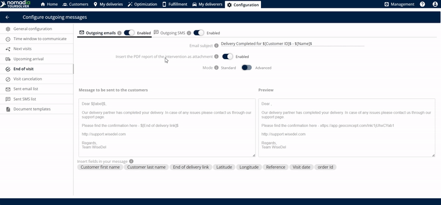
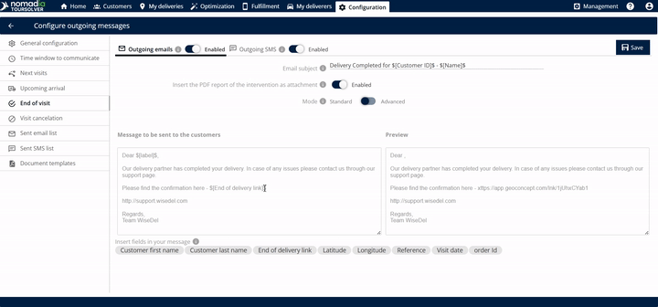
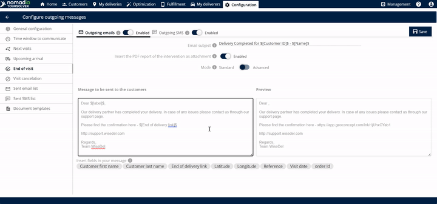
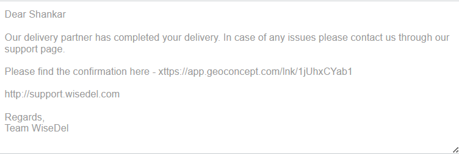

# Ende des Besuchs

## 1. Einführung

Das **Ende des Besuchs** Die Kommunikationseinstellung ermöglicht es Ihnen, automatische Follow-up-Nachrichten an Ihren Kunden zu versenden.

**Was ist das Ende des Besuchs?** Es ist der Prozess, der **nach Abschluss der Lieferung stattfindet**. Nach Abschluss erhält der Kunde automatisch eine E-Mail mit einer angehängten PDF-Datei.

**Der PDF-Liefernachweis (PoD)** Diese angehängte PDF dient als offizieller Liefernachweis. Sie bestätigt für den Kunden wesentliche Details, darunter:

* Der Name des Kunden
* Die Adresse des Kunden
* Während des Besuchs gesammelte Unterschriften

## 2. Anfangskonfiguration

Bevor Sie Ihre erste Nachricht senden, müssen Sie die grundlegenden Kommunikationskanäle aktivieren.

1. **Zugriff auf die Einstellungen für das Ende des Besuchs:**
   * Klicken Sie auf die **Ende des Besuchs** Option, um auf den Konfigurationsbildschirm zuzugreifen.

2. **Ausgehende Kanäle aktivieren:**
   * Aktivieren Sie die **ausgehenden E-Mails** Option

3. **Legen Sie den E-Mail-Betreff fest**

4. Aktivieren Sie den Schalter, um den PoD als PDF-Datei zu senden

5. Klicken Sie auf die **Speichern** Schaltfläche, um Änderungen an der bearbeiteten Vorlage zu übernehmen.

## 3. Funktionsbeschreibungen mit Vorteilen

Diese Funktion bietet Flexibilität und eine klare Zustellungsdokumentation.

| Funktion                              | Beschreibung                                                                                                                                                      |
| ------------------------------------- | ----------------------------------------------------------------------------------------------------------------------------------------------------------------- |
| **ETA-Link**                          | Ein Link mit der voraussichtlichen Ankunftszeit (ETA) wird automatisch erstellt und gesendet, sobald die Lieferung abgeschlossen ist.                             |
| **Bearbeitung des E-Mail-Betreffs**   | Sie können den **E-Mail-Betreff** eingeben und anpassen, damit Kunden sofort den Zweck der Nachricht erkennen.                                                    |
| **Bearbeitung des Nachrichtentextes** | Sie können frei **den Nachrichtentext bearbeiten** der an Ihre Kunden gesendet wird, was personalisierte Formulierungen und wichtige Details ermöglicht           |
| **Personalisierungs-Tags ($)**        | Wenn Sie das **Dollarzeichen** ($) eingeben, werden Optionen angezeigt, die Sie direkt in den E-Mail-Text einfügen und bearbeiten können, was Ihnen Zeit spart.   |
| **Vorschaufenster**                   | Bevor Sie speichern, können Sie die **Vorschau** der genauen Nachricht sehen, die gesendet wird, um sicherzustellen, dass sie professionell und korrekt aussieht. |
| **Live-Standortverfolgung**           | Der Link ermöglicht es dem Kunden, den Live-Standort der Lieferung (oder des Zustellers) zu verfolgen.                                                            |
| **Ausgehende E-Mail**                 | Option, um das Senden des ETA-Links per E-Mail zu aktivieren.                                                                                                     |
| **Ausgehende SMS**                    | Option, um das Senden des ETA-Links per SMS zu aktivieren.                                                                                                        |

## 4. Anpassung und Überprüfung des Betreffs

Befolgen Sie diese Schritte, um den Nachrichtentext anzupassen und das endgültige Erscheinungsbild der E-Mail zu bestätigen.

1. **Wählen Sie den Kommunikationsmodus:**
   * Ändern Sie den Kommunikations **modus** zu **standard** oder **erweitert** je nach dem von Ihnen benötigten Detaillierungsgrad.

2. **Sehen Sie die aktuelle Nachricht an:**
   * Schauen Sie sich den Abschnitt an, der die **an den Kunden zu sendende Nachricht**.
3. **Bearbeiten des Nachrichtentextes (optional):**
   * Wenn Sie den Inhalt anpassen müssen, können Sie **diesen E-Mail-Text bearbeiten**.

4.  **Vorschau der finalen E-Mail:**

    * Überprüfen Sie den **Betreff:** Prüfen Sie den **Vorschau** Bereich, um genau zu sehen, wie die endgültige E-Mail für den Kunden aussehen wird. Dies ist Ihre Gelegenheit, die Nachricht vor dem Speichern zu überprüfen
    * **Personalisierte Informationen einfügen (optional)** Um dynamische Informationen (wie den Namen eines Kunden oder spezifische Termindetails) einzufügen, geben Sie das **Dollarzeichen** ($). Dies zeigt Optionen an, die Sie verwenden können, um den E-Mail-Text zu bearbeiten.

    > 💡 **Tipp:** Die Verwendung von Personalisierungs-Tags lässt die Nachricht direkter und professioneller wirken.

5. **Konfiguration speichern:**
   * Sobald Sie mit den Einstellungen und der Vorschau zufrieden sind, klicken Sie auf **Speichern**.

6. Der Kunde wird die folgende E-Mail erhalten

<figure><figcaption></figcaption></figure>

***

## 5. Produktivitätstipps

Verwenden Sie diese Tipps, um die Effektivität und Klarheit Ihrer Kundenkommunikation zu maximieren.

* **💡 Vorabprüfung des PoD-Inhalts:** Denken Sie daran, dass der PDF-Anhang entscheidend ist. Sie können sich daran erinnern, dass der Kunde innerhalb des Anhangs seinen Namen, seine Adresse und Unterschriften überprüfen wird.
* **💡 Verwenden Sie die Vorschau häufig:** Bevor Sie Änderungen speichern, nutzen Sie die Vorschaufunktion, um Formatierungen doppelt zu prüfen und sicherzustellen, dass der Nachrichtentext korrekt lesbar ist. Die Vorschau zeigt genau, was der Kunde sehen wird.
* **💡 Überprüfen Sie die Einbindung des Anhangs:** Stellen Sie stets sicher, dass Sie die Option aktiviert haben, **Den PDF-Bericht der Intervention als Anhang einfügen**. Dies gewährleistet, dass der erforderliche Liefernachweis enthalten ist.
