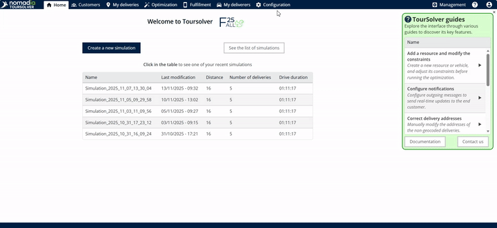
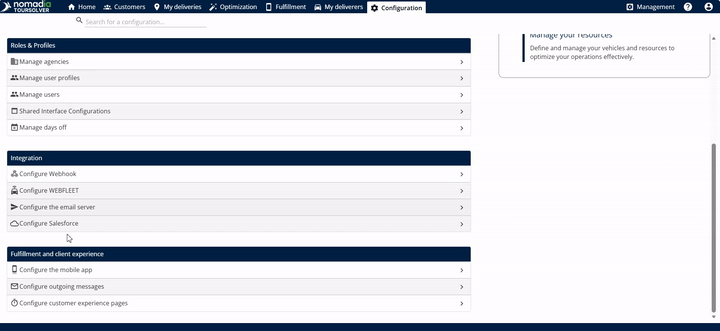
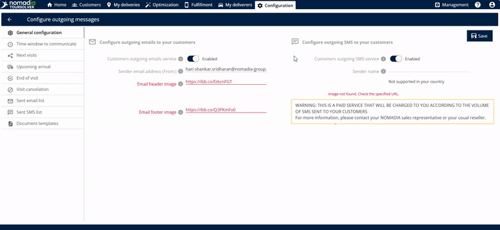
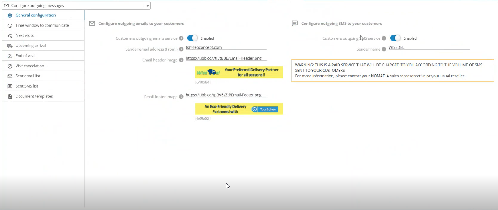
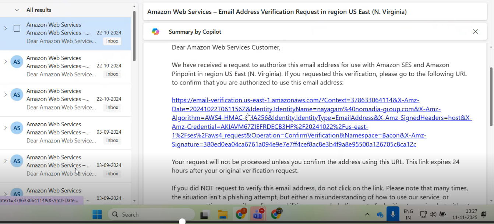
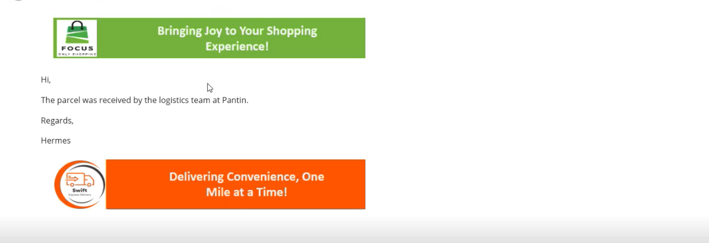

# Allgemeine Konfiguration

## 1. Einführung

Das **Allgemeine Konfiguration der Kundenkommunikation** Der Bildschirm ermöglicht es Ihnen, die grundlegenden Einstellungen zum Versenden ausgehender Nachrichten an Ihre Kunden zu aktivieren, zu deaktivieren und anzupassen. Sie haben die Kontrolle über beide **ausgehender E-Mail-Dienst für Kunden** und die **ausgehender SMS-Dienst für Kunden**.

## 2. Anfangskonfiguration

Um mit der Konfiguration Ihrer Kundenkommunikationspräferenzen zu beginnen, müssen Sie zum Bildschirm für die allgemeine Konfiguration navigieren:

1. **Beginnen Sie von der Startseite aus:** Gehen Sie von der **Startseite**.

2. Klicken Sie auf **Konfiguration Ausgehende Nachricht**

3. **Öffnen Sie die allgemeine Konfiguration:** Sie gelangen zum **Allgemeine Konfiguration** Bildschirm.

***

## 3. Funktionsbeschreibungen und Vorteile

Dieser Konfigurationsbereich verwaltet zwei leistungsstarke Möglichkeiten, wie Sie Ihre Kunden erreichen können:

| Funktion                                 | Beschreibung & Nützlichkeit                                                                                                                                                           |
| ---------------------------------------- | ------------------------------------------------------------------------------------------------------------------------------------------------------------------------------------- |
| **Ausgehender E-Mail-Dienst für Kunden** | Ermöglicht dem System, E-Mails im Namen Ihrer Kunden zu versenden. **Vorteil:** Sie können das Aussehen Ihrer E-Mails mit Branding-Elementen wie Kopf- und Fußzeilenbildern anpassen. |
| **Ausgehender SMS-Dienst für Kunden**    | Ermöglicht dem System, Textnachrichten (SMS) direkt an Kunden zu senden. **Vorteil:** Bietet schnelle, direkte Kommunikation für dringende oder wichtige Aktualisierungen.            |

**Wichtige Überlegungen zu SMS:**

* ⚠️ **Warnung: Kostenpflichtiger Dienst** – Die Aktivierung des ausgehenden SMS-Dienstes ist ein **kostenpflichtiger Dienst**. Ihnen werden Gebühren basierend auf dem Volumen der an Ihre Kunden gesendeten SMS-Nachrichten berechnet.
* **Zeichenbegrenzung** – Jede Standard-SMS-Nachricht darf **160 Zeichen**. Wenn Ihre Nachricht 160 Zeichen überschreitet, wird das System automatisch **die SMS in zwei SMS-Nachrichten aufteilen**.

***

## 4. Einrichten der Kundenkommunikation

Dieser Abschnitt führt Sie durch den Prozess zur Einrichtung und Aktivierung sowohl Ihres E-Mail- als auch Ihres SMS-Kommunikationskanals.

#### Aktivieren und Anpassen ausgehender E-Mails

Verwenden Sie diese Schritte, um die E-Mail-Kommunikation zu aktivieren und sicherzustellen, dass Ihre E-Mails mit Ihren Markenbildern professionell aussehen.

1. **E-Mail-Dienst aktivieren:** Sobald Sie sich auf dem Bildschirm für die allgemeine Konfiguration befinden, aktivieren Sie das **ausgehender E-Mail-Dienst für Kunden**.
2. **Absender-E-Mail eingeben:** Geben Sie die erforderliche **Absender-E-Mail-Adresse**.

3. **Kopf-/Fußzeilenbild-Link hinzufügen (optional):** Geben Sie die **Kopf-/Fußzeilenbild-Link**. Dieser enthält oft rechtliche Informationen oder Kontaktdaten. 💡 **Tipp:** Wenn Sie keinen Link für das Kopfzeilenbild und keinen Link für das Fußzeilenbild eingeben, wird die resultierende E-Mail ohne diese visuellen Elemente gesendet.

#### Aktivieren ausgehender SMS

1. **SMS-Dienst aktivieren:** Suchen Sie und aktivieren Sie das **ausgehender SMS-Dienst für Kunden**.
   * **Kontext:** Wenn Sie diesen Dienst aktivieren, erhalten Ihre Kunden vom System beginnende SMS-Nachrichten.

#### Änderungen speichern und Ihre E-Mail validieren

Um Ihre Kommunikationskonfiguration zu aktivieren, müssen Sie Ihre Änderungen speichern und einen wichtigen Validierungsschritt abschließen.

2. **Validierungs-E-Mail erhalten:** Nach dem Klicken **speichern**, sendet das System automatisch eine E-Mail an die von Ihnen angegebene Absenderadresse. Diese E-Mail enthält einen **Link zur Validierung der E-Mail**.

<figure><figcaption></figcaption></figure>

3. **Validierungslink anklicken:** Gehen Sie zu Ihrem Posteingang, öffnen Sie die Validierungs-E-Mail und klicken Sie auf den bereitgestellten Link.

<figure><figcaption></figcaption></figure>

4. **Aktivierung bestätigt:** Sobald Sie auf den Link klicken, wird das System autorisiert, E-Mails an Kunden zu senden **in Ihrem Namen**.

<figure><figcaption></figcaption></figure>

***

## 5. Produktivitätstipps

Hier sind einige Tipps, um Ihre Effektivität bei der Nutzung der Einstellungen der allgemeinen Konfiguration zu maximieren:

* 💡 **Konsistentes Branding:** Versuchen Sie immer, sowohl den **Link zum Kopfzeilenbild** und die **Link zum Fußzeilenbild**. Die Verwendung dieser Links hilft, ein professionelles Branding für alle an Ihre Kunden gesendeten E-Mails beizubehalten.
* ⚠️ **Achten Sie auf Ihre Zeichenanzahl:** Der Versand von SMS ist ein kostenpflichtiges Abonnement und beim Versenden von SMS-Nachrichten sollten Sie die **160-Zeichen-Grenze**. Halten Sie Ihre Nachrichten kurz, um zu vermeiden, dass sie in zwei separate, berechenbare Nachrichten aufgeteilt werden.
* 💡 **Sofortige Validierung:** Um eine nahtlose E-Mail-Zustellung sicherzustellen, schließen Sie den Validierungsschritt unmittelbar nach dem Klicken auf **speichern**Der Validierungslink bestätigt, dass das System (TourSolver) die Erlaubnis hat, Nachrichten mit der von Ihnen gewählten Absenderadresse zu versenden.
