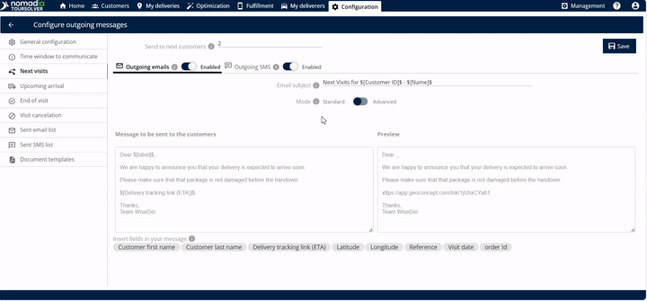
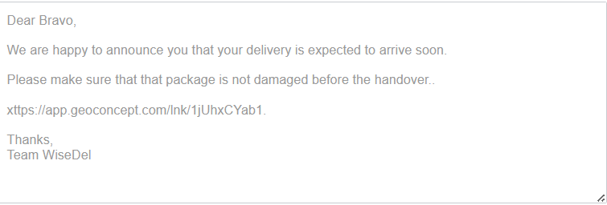

# Nächste Besuche

## 1. Einführung

Das **Nächste Besuche** Die Funktion ist darauf ausgelegt, Benachrichtigungen zu automatisieren und Ihre bevorstehenden Kunden wissen zu lassen, dass Sie unterwegs sind. Dies gewährleistet eine reibungslose Kommunikation und bessere Vorbereitung auf Ihre Ankunft.

Sie können genau auswählen, wie viele bevorstehende Kunden diese Nachricht erhalten, den Inhalt anpassen und entscheiden, ob sie per E-Mail oder SMS gesendet werden soll.

## 2. Anfangskonfiguration

Ihr erster Schritt besteht darin, festzulegen, wie Sie Ihre bevorstehenden Kunden benachrichtigen werden.

**Zugriff auf die Funktion „Nächste Besuche":** Klicken Sie auf **nächste Besuche**.

**Definieren Sie die Zielanzahl der Kunden** Geben Sie die Anzahl der bevorstehenden Kunden an, die Sie benachrichtigen möchten. Sie können wählen, ob eine Benachrichtigung an den nächsten, die nächsten zwei oder die nächsten drei Kunden gesendet wird.

* Wenn Sie eingeben **eins**, wird die E-Mail an den nächsten Kunden gesendet.
* Wenn Sie eingeben **zwei**, wird die E-Mail an die nächsten zwei Kunden gesendet.
* Wenn Sie eingeben **drei** (oder jede gewünschte Zahl), wird die E-Mail an diese Anzahl von Kunden gesendet.

***

## 3. Funktionsbeschreibungen mit Vorteilen

Die Stärke dieses Tools liegt in seiner Anpassungsfähigkeit und dem Auslösemechanismus.

| Funktion                              | Beschreibung                                                                                                                                                      |
| ------------------------------------- | ----------------------------------------------------------------------------------------------------------------------------------------------------------------- |
| **ETA-Link**                          | Ein Link mit der voraussichtlichen Ankunftszeit (ETA) wird automatisch erstellt und gesendet, sobald die Lieferung abgeschlossen ist.                             |
| **Bearbeitung des E-Mail-Betreffs**   | Sie können den **E-Mail-Betreff** eingeben und anpassen, damit Kunden sofort den Zweck der Nachricht erkennen.                                                    |
| **Bearbeitung des Nachrichtentextes** | Sie können frei **den Nachrichtentext bearbeiten** der an Ihre Kunden gesendet wird, was personalisierte Formulierungen und wichtige Details ermöglicht           |
| **Personalisierungs-Tags ($)**        | Wenn Sie das **Dollarzeichen** ($) eingeben, werden Optionen angezeigt, die Sie direkt in den E-Mail-Text einfügen und bearbeiten können, was Ihnen Zeit spart.   |
| **Vorschaufenster**                   | Bevor Sie speichern, können Sie die **Vorschau** der genauen Nachricht sehen, die gesendet wird, um sicherzustellen, dass sie professionell und korrekt aussieht. |
| **Live-Standortverfolgung**           | Der Link ermöglicht es dem Kunden, den Live-Standort der Lieferung (oder des Zustellers) zu verfolgen.                                                            |
| **Ausgehende E-Mail**                 | Option, um das Senden des ETA-Links per E-Mail zu aktivieren.                                                                                                     |
| **Ausgehende SMS**                    | Option, um das Senden des ETA-Links per SMS zu aktivieren.                                                                                                        |

## 4. Passen Sie die Kundenkommunikation an und speichern Sie sie

Diese Aufgabe stellt sicher, dass Ihre bevorstehenden Kunden eine maßgeschneiderte Nachricht erhalten, die sie über Ihre bevorstehende Ankunft informiert.

1. **Geben Sie den E-Mail-Betreff ein:** Suchen Sie das Feld für den E-Mail-Betreff und geben Sie einen klaren, prägnanten Titel ein.

2. **Bearbeiten Sie den Nachrichteninhalt** Passen Sie den Nachrichtentext an, der an Ihre Kunden gesendet wird.
3.  **Personalisierte Informationen einfügen (optional)** Um dynamische Informationen (wie den Namen eines Kunden oder spezifische Termindetails) einzufügen, geben Sie das **Dollarzeichen** ($). Dies zeigt Optionen an, die Sie verwenden können, um den E-Mail-Text zu bearbeiten.

    > 💡 **Tipp:** Die Verwendung von Personalisierungs-Tags lässt die Nachricht direkter und professioneller wirken.

4. **Überprüfen Sie den Betreff:** Prüfen Sie den **Vorschau** Bereich, um genau zu sehen, wie die endgültige E-Mail für den Kunden aussehen wird. Dies ist Ihre Chance, die Nachricht vor dem Speichern zu überprüfen.
5. **Speichern Sie Ihre Einstellungen** Sobald Sie alle notwendigen Informationen eingegeben und geändert haben, klicken Sie auf **speichern**.

6. Der Kunde erhält die folgende E-Mail.&#x20;

<figure><figcaption></figcaption></figure>

***

## 5. Produktivitätstipps

Hier sind ein paar Tipps, um die Effizienz der Next Visits-Kommunikationsfunktion zu maximieren:

1. **Maximieren Sie die Anpassung:** Verwenden Sie beim Bearbeiten des Nachrichtentextes stets das Dollarzeichen ($). Dies stellt sicher, dass Sie verfügbare Felder für dynamische Inhalte nutzen und eine professionelle und detaillierte Kommunikation erstellen, ohne jedes Mal manuell eingreifen zu müssen.
