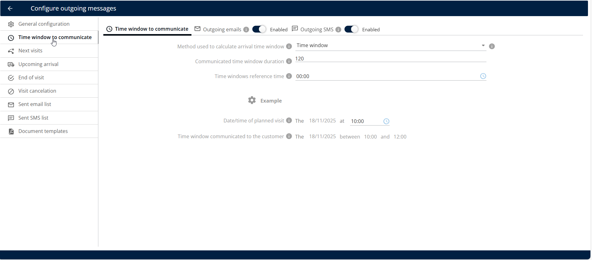
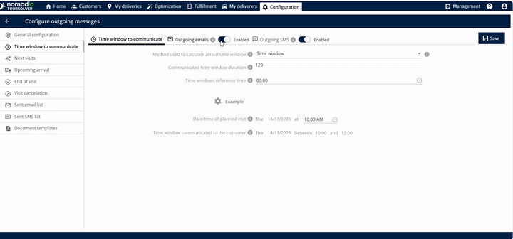
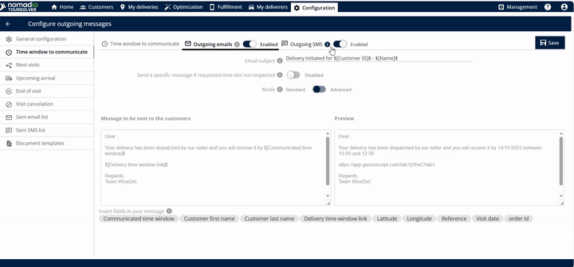
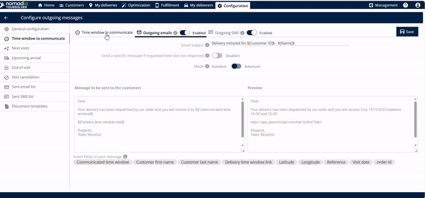
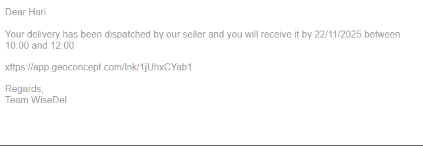

# Zeitfenster zur Kommunikation

## 1. Einführung

Das **Zeitfenster zur Kommunikation** Funktion ermöglicht es Ihnen, den genauen Zeitraum festzulegen, der Ihrem Kunden bezüglich eines bevorstehenden Besuchs mitgeteilt wird. Dies berechnet das Ankunftsfenster und verwaltet ausgehende Kommunikation per E-Mail und SMS.

## 2. Anfangskonfiguration

1. Klicken Sie auf **Zeitfenster zur Kommunikation**.

<figure><figcaption></figcaption></figure>

***

## 3. Funktionsbeschreibungen und Vorteile

Diese Funktion ist leistungsstark, weil sie Ihnen erlaubt, genau zu steuern, wie die Ankunftsinformationen berechnet und übermittelt werden.

| Funktion                              | Beschreibung                                                                                                                                                      |
| ------------------------------------- | ----------------------------------------------------------------------------------------------------------------------------------------------------------------- |
| **ETA-Link**                          | Ein Link mit der voraussichtlichen Ankunftszeit (ETA) wird automatisch erstellt und gesendet, sobald die Lieferung abgeschlossen ist.                             |
| **Bearbeitung des E-Mail-Betreffs**   | Sie können den **E-Mail-Betreff** eingeben und anpassen, damit Kunden sofort den Zweck der Nachricht erkennen.                                                    |
| **Bearbeitung des Nachrichtentextes** | Sie können frei **den Nachrichtentext bearbeiten** der an Ihre Kunden gesendet wird, was personalisierte Formulierungen und wichtige Details ermöglicht           |
| **Personalisierungs-Tags ($)**        | Wenn Sie das **Dollarzeichen** ($) eingeben, werden Optionen angezeigt, die Sie direkt in den E-Mail-Text einfügen und bearbeiten können, was Ihnen Zeit spart.   |
| **Vorschaufenster**                   | Bevor Sie speichern, können Sie die **Vorschau** der genauen Nachricht sehen, die gesendet wird, um sicherzustellen, dass sie professionell und korrekt aussieht. |
| **Live-Standortverfolgung**           | Der Link ermöglicht es dem Kunden, den Live-Standort der Lieferung (oder des Zustellers) zu verfolgen.                                                            |
| **Ausgehende E-Mail**                 | Option, um das Senden des ETA-Links per E-Mail zu aktivieren.                                                                                                     |
| **Ausgehende SMS**                    | Option, um das Senden des ETA-Links per SMS zu aktivieren.                                                                                                        |

## 4. Einrichtung des Kundenkommunikations-Zeitfensters und der Benachrichtigungen

Befolgen Sie diese Schritte, um das genaue Zeitfenster festzulegen und die Kommunikation für den Kundenbesuch zu aktivieren.

1. **Auf die Funktion zugreifen:** Klicken Sie auf **Zeitfenster zur Kommunikation**.
2. **Berechnungsmethode festlegen:**
   * Wählen Sie die Methode für das Zeitfenster, die zur Berechnung des Ankunftszeitfensters verwendet wird.

3. **Dauer festlegen:**
   * Geben Sie die Dauer für das kommunikative Zeitfenster ein.

💡 \*\*Tipp:\*\* Wenn Sie \*\*120 Minuten\*\* eingeben, ergibt sich ein 2‑stündiges Fenster, das dem Kunden mitgeteilt wird (z. B. 10:00 bis 12:00 Uhr).

4\. **Referenzzeit auswählen:**

5. **Geplante Besuchsdaten eingeben:**
   * Suchen Sie das **Datum und Uhrzeit des geplanten Besuchs** Feld.

6. **Berechnetes Zeitfenster überprüfen:**
   * Das System zeigt das **dem Kunden mitgeteilte Zeitfenster**.
   * Zum Beispiel, wenn Sie die Dauer auf 2 Stunden einstellen, könnte das System das Fenster als 10:00 bis 12:00 Uhr berechnen.
7.  **E-Mail-Kommunikation aktivieren:**

    * Sie können die **ausgehenden E-Mails** Option aktivieren.
    * Überprüfen Sie die Nachricht, die dem Kunden unter diesem Abschnitt gesendet werden muss.
    * **Personalisierte Informationen einfügen (optional)** Um dynamische Informationen (wie den Namen eines Kunden oder spezifische Termindetails) einzufügen, geben Sie das **Dollarzeichen** ($). Dies zeigt Optionen an, die Sie verwenden können, um den E-Mail-Text zu bearbeiten.

    &#x20;      💡 **Tipp:** Die Verwendung von Personalisierungs-Tags lässt die Nachricht direkter und professioneller wirken

8.  **zu aktivieren**

    * Sie können auch die **SMS-Kommunikation aktivieren (optional):** Option aktivieren.
    * **Personalisierte Informationen einfügen (optional)** Um dynamische Informationen (wie den Namen eines Kunden oder spezifische Termindetails) einzufügen, geben Sie das **Dollarzeichen** ($). Dies zeigt Optionen an, die Sie verwenden können, um den E-Mail-Text zu bearbeiten.

    > 💡 **Tipp:** Die Verwendung von Personalisierungs-Tags lässt die Nachricht direkter und professioneller wirken.

9. **Speichern Sie Ihre Einstellungen:**

10. Der Kunde wird die folgende E-Mail erhalten

<figure><figcaption></figcaption></figure>

## 5. Produktivitätstipps

Diese Tipps helfen Ihnen, effizienter zu arbeiten und eine reibungslose Kommunikation mit Ihren Kunden zu gewährleisten:

* **Vorschaufunktion verwenden:** Verwenden Sie stets die Nachrichten- **Vorschau** Option, die sowohl für ausgehende E‑Mails als auch für ausgehende SMS verfügbar ist. Dies hilft Ihnen zu bestätigen, was der Kunde genau sehen wird, bevor Sie Ihre Einstellungen speichern, und stellt Genauigkeit und Klarheit sicher.
* **Dauern klar halten:** Wenn Sie die **Kommunizierte Zeitfenster-Dauer**, wählen Sie gängige Intervalle (wie 60 Minuten oder 120 Minuten), die für Kunden leicht verständlich sind. Ein klares, definiertes Fenster vermeidet Verwirrung.
