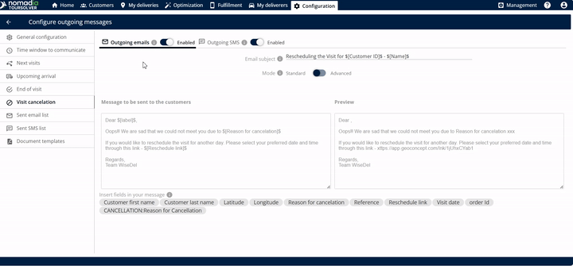
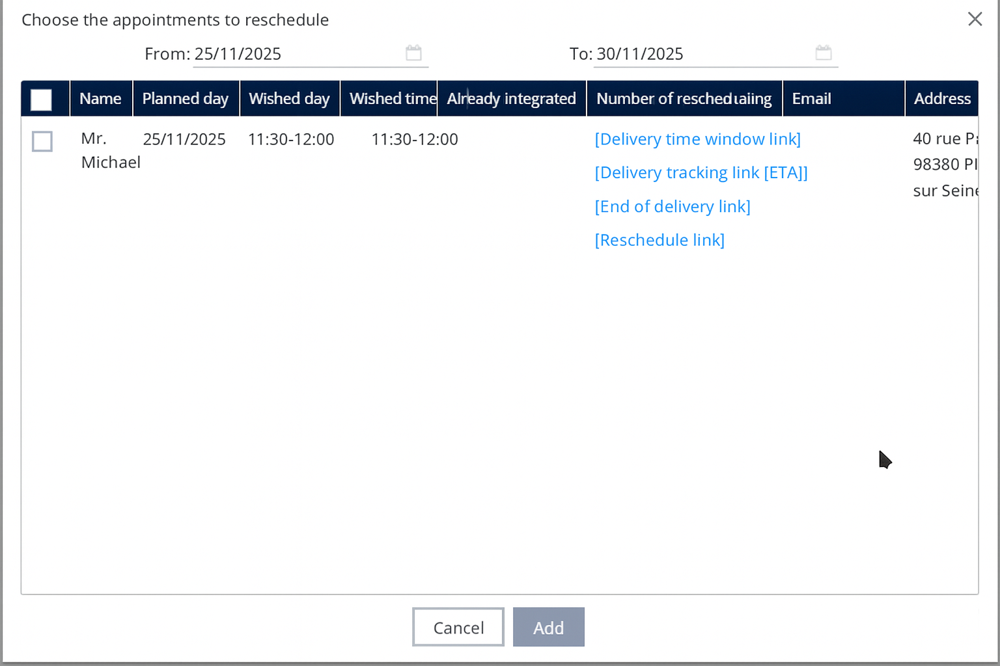

# Terminabsage

## 1. Einführung

Dieser Vorgang ermöglicht es Ihnen, einen Besuch als storniert zu markieren und gleichzeitig eine Aktion auszulösen, die den Endkunden auffordert, ein neues Datum und eine neue Uhrzeit für die Neuplanung auszuwählen.

## 2. Anfangskonfiguration&#x20;

Bevor Sie eine Stornierung verarbeiten, müssen Sie sicherstellen, dass die Kommunikationskanäle aktiv sind, damit der Kunde den Link zur Neuplanung erhält.

1. **Zugriff auf die Stornierungseinstellungen:** Klicken Sie auf die **Besuchsstornierung** Option.
2. **Ausgehende Nachrichten aktivieren:** Stellen Sie sicher, dass beide Arten ausgehender Kommunikation eingeschaltet sind:
   * **Ausgehende E-Mails**
   * **Ausgehende SMS**
3. **Betreff festlegen (E-Mails und SMS):** Geben Sie das spezifische **Betreff** an, das der Kunde sehen soll.

***

## 3. Funktionsbeschreibungen und Vorteile

Diese Funktion vereinfacht die Kommunikation und Logistik, wenn ein Zustellversuch aufgrund der Nichtverfügbarkeit des Kunden fehlschlägt.

| Funktion                              | Beschreibung                                                                                                                                                      |
| ------------------------------------- | ----------------------------------------------------------------------------------------------------------------------------------------------------------------- |
| **ETA-Link**                          | Ein Link mit der voraussichtlichen Ankunftszeit (ETA) wird automatisch erstellt und gesendet, sobald die Lieferung abgeschlossen ist.                             |
| **Bearbeitung des E-Mail-Betreffs**   | Sie können den **E-Mail-Betreff** eingeben und anpassen, damit Kunden sofort den Zweck der Nachricht erkennen.                                                    |
| **Bearbeitung des Nachrichtentextes** | Sie können frei **den Nachrichtentext bearbeiten** der an Ihre Kunden gesendet wird, was personalisierte Formulierungen und wichtige Details ermöglicht           |
| **Personalisierungs-Tags ($)**        | Wenn Sie das **Dollarzeichen** ($) eingeben, werden Optionen angezeigt, die Sie direkt in den E-Mail-Text einfügen und bearbeiten können, was Ihnen Zeit spart.   |
| **Vorschaufenster**                   | Bevor Sie speichern, können Sie die **Vorschau** der genauen Nachricht sehen, die gesendet wird, um sicherzustellen, dass sie professionell und korrekt aussieht. |
| **Live-Standortverfolgung**           | Der Link ermöglicht es dem Kunden, den Live-Standort der Lieferung (oder des Zustellers) zu verfolgen.                                                            |
| **Ausgehende E-Mail**                 | Option, um das Senden des ETA-Links per E-Mail zu aktivieren.                                                                                                     |
| **Ausgehende SMS**                    | Option, um das Senden des ETA-Links per SMS zu aktivieren.                                                                                                        |

💡 **Tipp:** Der Text der E-Mail enthält automatisch den **Stornierungsgrund** und die **Neuplanungsdatum** Informationen.

**Personalisierte Informationen einfügen (optional)** Um dynamische Informationen (wie den Namen eines Kunden oder spezifische Termindetails) einzufügen, geben Sie das **Dollarzeichen** ($). Dies zeigt Optionen an, die Sie verwenden können, um den E-Mail-Text zu bearbeiten.

💡 **Tipp:** Die Verwendung von Personalisierungs-Tags lässt die Nachricht direkter und professioneller wirken.

#### Verwaltung neu geplanter Termine&#x20;

Nachdem ein Besuch storniert wurde, muss der Zusteller den Termin wieder in den Zeitplan aufnehmen, sobald ein neues Datum ausgewählt wurde.

**Daten finden**

1. **Zugriff auf Erfüllung:** Gehen Sie zum **Erfüllungs-Tab**.
2. **Anzeigte Liste der Stornierungen:** Klicken Sie auf **zur Neuplanung**.
3. **Daten überprüfen:** Sie können **hier die neu geplanten Daten einsehen**.

<figure><figcaption></figcaption></figure>

**Den Termin wieder in den Zeitplan aufnehmen**

1. **Zugriff auf Zusteller-Tools:** Der Zusteller sollte auf **meine Lieferungen**.
2. **klicken:** Klicken Sie auf **Termine hinzufügen zur Neuplanung**.
3. **Auflisten und Hinzufügen:** **Listen Sie die Daten hier auf** und klicken Sie **hinzufügen**.

**Erwartetes Ergebnis:** Die neu geplanten Besuche **werden erfolgreich zur nächsten Simulation/Optimierung hinzugefügt**.

<figure><figcaption></figcaption></figure>

## 5. Produktivitätstipps

* **Immer beides aktivieren:** Für maximale Kundenerreichbarkeit stellen Sie sicher, dass Sie **die ausgehenden E-Mails und die ausgehenden SMS aktivieren** bei der Einrichtung der Stornierung. Diese Funktion ist über mehrere Kanäle verfügbar und stellt sicher, dass Kunden darauf zugreifen können, auch wenn eine Methode verpasst wird.
* **Verwenden Sie die Vorschaufunktion:** Bevor Sie auf **speichern**klicken, nutzen Sie immer die Funktion, um **die Vorschau der E-Mail zu sehen**zu. Dies bestätigt, dass der Stornierungsgrund und der Link zur Neuplanung korrekt angezeigt werden und verhindert Kommunikationsfehler.
* **Neu geplante Elemente verfolgen:** Prüfen Sie regelmäßig die **Erfüllungs-Tab** unter **zur Neuplanung**. Dies stellt sicher, dass keine stornierten Besuche übersehen werden und hält Ihren Logistik-Workflow aktuell.
