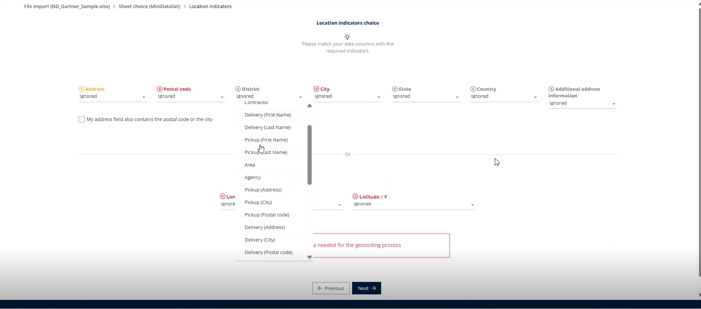

# 12. Wie optimiere ich die Geokodierung in TourSolver?

* **Genaue und vollständige Adressen angeben**\
  Stellen Sie sicher, dass jede Adresse Straßenname, Hausnummer, Postleitzahl, Stadt und Land enthält. Saubere und einheitliche Daten verbessern die Geokodierungsergebnisse.
*   **Verwenden Sie separate Felder für jede Adresskomponente**\
    TourSolver unterstützt zwei Formate zur Eingabe von Adressinformationen:

    1. **Strukturierte Spalten** – Straße, Postleitzahl, Stadt und Land jeweils separat eingeben.
    2. **Ein einzelnes kombiniertes Feld** – Vollständige Adresse in einer Spalte eingeben.

    👉 Um eine genaue Geokodierung zu gewährleisten, **wählen Sie ein Format und verwenden Sie es konsequent**. Mischen Sie in demselben Datensatz nicht strukturierte Spalten mit einem kombinierten Feld, da dies Fehler oder Inkonsistenzen bei der Adresseerkennung verursachen kann.
*   **Prüfen Sie die Bezirksinformationen**\
    Um die Geokodierungsgenauigkeit zu erhöhen, **geben Sie den korrekten Bezirk an** wenn Sie Adressdaten eingeben. TourSolver enthält jetzt eine spezielle **Bezirksspalte**, die dem System hilft, die Suche einzugrenzen und das richtige Gebiet effektiver zu finden.

    👉 Die konsequente Verwendung des Bezirksfeldes stellt sicher, dass Adressen der richtigen geografischen Zone zugeordnet werden und reduziert Fehler bei der Routenplanung.

<figure><figcaption></figcaption></figure>

* **Bevorzugen Sie GPS-Koordinaten, wenn vorhanden**\
  Wenn Sie Werte für Breiten- und Längengrad haben, fügen Sie diese hinzu. TourSolver verwendet diese direkt und überspringt die Adressgeokodierung, was zu höherer Genauigkeit führt.
* **Überprüfen Sie die Geokodierungsqualität nach dem Import**\
  Verwenden Sie die Indikatoren zur Geokodierungsqualität, um falsche oder minderwertige Punkte zu identifizieren und diese in den Daten zu korrigieren.
*   **Option zur Neupositionierung in der mobilen App**\
    Um die Geokodierungsqualität zu verbessern, bietet TourSolver eine **Neupositionierungsoption** in der mobilen Anwendung. Diese Funktion erlaubt es Benutzern, **den Standort direkt von ihrem Mobilgerät aus zu aktualisieren oder anzupassen**, um sicherzustellen, dass die erfasste Position genau ist und mit dem tatsächlichen Standort übereinstimmt.

    👉 Die Verwendung der Neupositionierungsoption hilft, kleinere Abweichungen zu korrigieren und erhöht die Genauigkeit der geokodierten Adressen in der Routenplanung.
