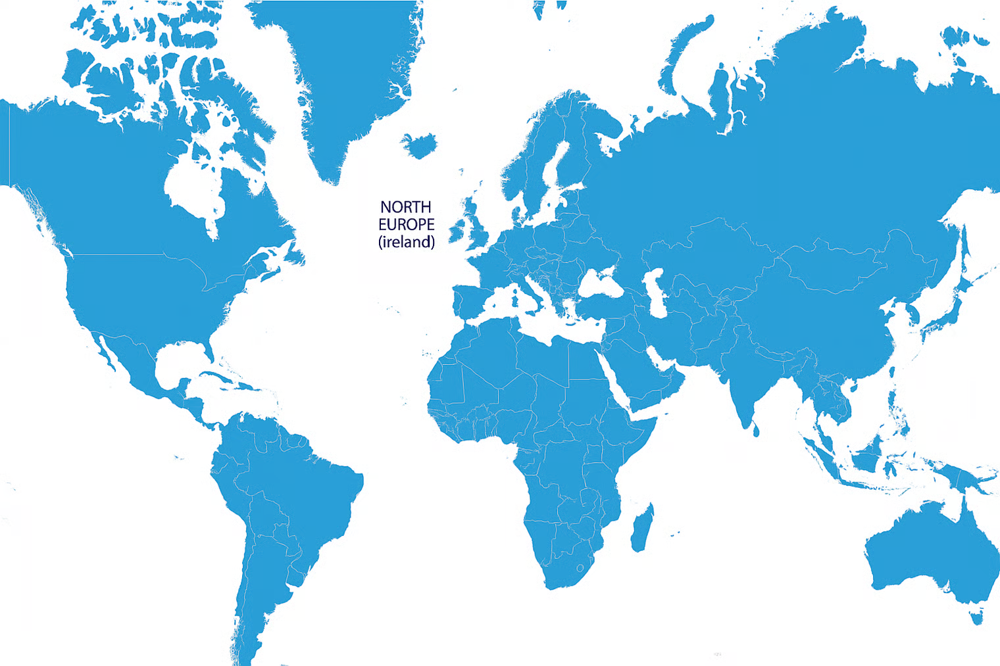

# 1. Wo werden meine Daten gehostet?

Wo Ihre Daten und die Infrastruktur, die zur Nutzung von TourSolver erforderlich sind, gespeichert werden, hängt vom Umfang Ihrer geografischen Abdeckung und damit letztlich davon ab, in welchem Land Sie sich befinden, wenn Sie Routenoptimierungen durchführen.&#x20;

Für [alle unterstützten Länder](https://www.toursolver.com/fr/faq/couverture-g%C3%A9ographique-de-toursolver) in TourSolver erfolgen das Hosting der Cloud-Infrastruktur und Ihrer Daten in Europa und Nordirland.

<figure><figcaption></figcaption></figure>
