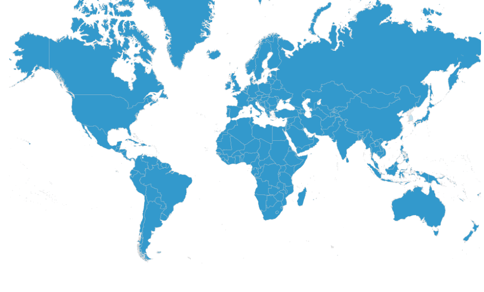

# 17. In welchen Ländern ist TourSolver verfügbar?

Stand **2. Mai 2018 (Version 5.0)**, bietet TourSolver Abdeckung für Routenplanung und Optimierung in **etwa 230 Ländern**, was **mehr als 7,2 Milliarden Menschen**.\
Mit jüngsten Ergänzungen wie **Bangladesch, Bhutan, Malediven, Nepal, Pakistan und Sri Lanka**, deckt TourSolver nun **fast den gesamten Planeten**.

### **🌍 Nicht abgedeckte Länder**

* **Nordkorea**
* **Südkorea**

<figure><figcaption></figcaption></figure>

Die Abdeckung ist nach Regionen organisiert, und einige Regionen beinhalten **geographische Sektorisierung** (verfügbar in der **Premium-Version**). Unten finden Sie die vollständige Liste der abgedeckten Länder und deren Verfügbarkeit in der Premium-Version.

***

### **🌍 Europa**

**Geographische Sektorisierung in der Premium-Version verfügbar**

ALBANIEN, DEUTSCHLAND, ANDORRA, ARMENIEN, ÖSTERREICH, AZERBAIDSCHAN, WEISSRUSSLAND, BELGIEN, BOSNIEN UND HERZEGOWINA, BRASILIEN, BULGARIEN, ZYPERN, KROATIEN, DÄNEMARK, SPANIEN, ESTLAND, RUSSLAND, FINNLAND, FRANKREICH, GEORGIEN, GRIECHENLAND, GRÖNLAND, UNGARN, INSEL MAN, FÄRÖER-INSELN, IRLAND, ISLAND, ITALIEN, KASACHSTAN, KIRGISISTAN, LETTLAND, LIECHTENSTEIN, LITAUEN, LUXEMBURG, MALTA, MONTENEGRO, NORWEGEN, USBEKISTAN, NIEDERLANDE, POLEN, PORTUGAL, NORDMAZEDONIEN, MOLDOVA, TSCHECHISCHE REPUBLIK, RUMÄNIEN, VEREINIGTES KÖNIGREICH, SERBIEN, SLOWAKEI, SLOWENIEN, SCHWEDEN, SCHWEIZ, TADSCHIKISTAN, TURKMENISTAN, TÜRKEI, UKRAINE.

***

### **🌍 Afrika & Naher Osten**

**Geographische Sektorisierung NICHT verfügbar in der Premium-Version**

Afghanistan, Südafrika, Algerien, Angola, Saudi-Arabien, Bahrain, Gazastreifen, Benin, Botswana, Burkina Faso, Burundi, Kamerun, Kap Verde, Komoren, Demokratische Republik Kongo, Republik Kongo, Elfenbeinküste, Dschibuti, Ägypten, Vereinigte Arabische Emirate, Eritrea, Äthiopien, Gabun, Gambia, Ghana, Guinea, Äquatorialguinea, Guinea-Bissau, Irak, Iran, Israel, Jordanien, Kenia, Kuwait, Lesotho, Libanon, Liberia, Libyen, Madagaskar, Malawi, Mali, Marokko, Mauritius, Mauretanien, Mayotte, Mosambik, Namibia, Niger, Nigeria, Oman, Uganda, Palästina, Katar, Zentralafrikanische Republik, Réunion, Ruanda, Westsahara, São Tomé und Príncipe, Senegal, Seychellen, Sierra Leone, Somalia, Sudan, Südsudan, St. Helena–Ascension–Tristan da Cunha, Swasiland (Eswatini), Syrien, Tansania, Tschad, Togo, Tunesien, Jemen, Sambia, Simbabwe.

***

### **🌍 Nord- & Zentralamerika**

**Geographische Sektorisierung in der Premium-Version verfügbar**

Bahamas, Belize, Bermuda, Kanada, Costa Rica, Kuba, Kaimaninseln, Dominikanische Republik, Guatemala, Honduras, Haiti, Jamaika, Mexiko, Nicaragua, Panama, Puerto Rico, El Salvador, Saint-Pierre und Miquelon, Turks- und Caicosinseln, Vereinigte Staaten, Britische Jungferninseln, Amerikanische Jungferninseln.

***

### **🌍 Südamerika & die Karibik**

**Geographische Sektorisierung NICHT verfügbar in der Premium-Version**

Aruba, Anguilla, Argentinien, Antigua und Barbuda, St. Eustatius, Saba, Bonaire, Saint-Barthélemy, Bolivien, Brasilien, Barbados, Chile, Kolumbien, Curaçao, Dominica, Ecuador, Falklandinseln, Guadeloupe, Grenada, Guyana, Französisch-Guayana, St. Kitts und Nevis, St. Lucia, Saint-Martin, Montserrat, Martinique, Peru, Paraguay, Südgeorgien und die Südlichen Sandwichinseln, Suriname, Sint Maarten, Trinidad und Tobago, Uruguay, Saint Vincent und die Grenadinen, Venezuela.

***

### **🌍 Asien**

**Geographische Sektorisierung NICHT verfügbar in der Premium-Version**

Bangladesch, Bhutan, China _(nur innerhalb Chinas verfügbar)_, Indien, Malediven, Nepal, Pakistan, Sri Lanka, Japan.

***

### **🌍 Südostasien**

**Geographische Sektorisierung NICHT verfügbar in der Premium-Version**

Brunei, Guam, Hongkong, Indonesien, Kambodscha, Laos, Macau, Myanmar, Mongolei, Marianen, Malaysia, Philippinen, Paracel-Inseln, Palau, Papua-Neuguinea, Singapur, Salomonen, Spratly-Inseln, Thailand, Osttimor, Vietnam, Taiwan.

***

### **🌍 Ozeanien**

**Geographische Sektorisierung NICHT verfügbar in der Premium-Version**

Australien, Mikronesien, Fidschi, Cookinseln, Marshallinseln, Kiribati, Nauru, Niue, Neukaledonien, Neuseeland, Französisch-Polynesien, Samoa, Amerikanisch-Samoa, Tokelau, Tonga, Tuvalu, Vanuatu, Wallis und Futuna.
