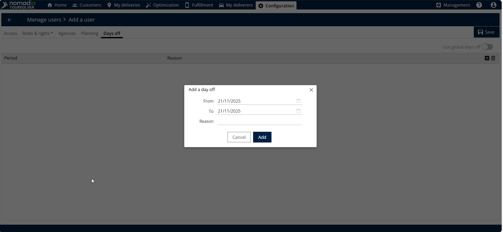

# Benutzer erstellen und bearbeiten

## 1. Einführung

Dieser Leitfaden bietet schrittweise Anweisungen zum Einrichten neuer Teammitglieder und zum Aktualisieren der Daten, Rollen oder Zeitpläne aktueller Benutzer. Wenn Sie diese einfachen Schritte befolgen, können Sie die Zugriffseinstellungen sicher und effizient verwalten!

## 2. Anfangskonfiguration

Der erste Schritt zum Erstellen oder Ändern eines Benutzers ist der Zugriff auf den Hauptkonfigurationsbereich von der Startseite aus.

Um mit dem Erstellen oder Ändern eines Benutzers zu beginnen, gehen Sie wie folgt vor:

1. Von der **Startseite**, gehen Sie zu den **Einstellungen.**
2. Klicken Sie auf **Benutzer verwalten.**

<figure><figcaption></figcaption></figure>

<figure><figcaption></figcaption></figure>

3. Klicken Sie auf **Aktionen**.
4. Klicken Sie auf **Hinzufügen**

<figure><figcaption></figcaption></figure>

## 3. Funktionsbeschreibungen und Vorteile

Beim Erstellen oder Ändern eines Benutzers arbeiten Sie mit mehreren wichtigen Abschnitten, um dessen Zugriff und Planung zu definieren.

| Abschnitt             | Zweck (Kontext)                                                                                              | Wichtige Aktionen                                                                                                  |
| --------------------- | ------------------------------------------------------------------------------------------------------------ | ------------------------------------------------------------------------------------------------------------------ |
| **Zugriff**           | Definiert die grundlegende Identität und die Anmeldeberechtigungen (Web und mobil) für den Benutzer.         | Geben Sie die Anmelde-ID, Namen ein und legen Sie das Anfangspasswort für den mobilen Benutzer fest                |
| **Rollen und Rechte** | Bestimmt, was der Benutzer innerhalb der Anwendung sehen und tun darf (z. B. Administrator, Optimierung).    | Aktivieren Sie die erforderlichen Rollen und Rechte, wie **Administrator** oder **Optimierung**.                   |
| **Agenturen**         | Weist die spezifischen Agenturen zu, für die der Benutzer verantwortlich ist oder auf die er zugreifen muss. | Wählen Sie die benötigten Agenturen aus und verwenden Sie die **Pfeil nach rechts** um sie zuzuweisen.             |
| **Planung**           | Ermöglicht Ihnen, die Einsatzzeiten für den Benutzer zu planen.                                              | Tippen Sie auf den Tag und die Uhrzeit, um die Einsatzzeit festzulegen, und tippen Sie dann auf **aktualisieren**. |
| **Freie Tage**        | Ermöglicht Ihnen, geplante freie Tage des Benutzers vorzuplanen und zu erfassen.                             | Geben Sie die **von Datum** und **bis-Datum** für die geplante Freistellung.                                       |

**Hinweis**: Planung & freie Tage sind nur für den mobilen Benutzer zugänglich. Rollen & Rechte sind nur für den Web-Benutzer zugänglich

## 4. Benutzer erstellen

Sie können einen Benutzer vollständig neu erstellen oder effizient einen vorhandenen Benutzer ändern, indem Sie dessen Daten als Vorlage verwenden.

### Einen Benutzer von Grund auf neu erstellen

Dies ist erforderlich, wenn ein neuer Mitarbeiter eingearbeitet wird, der eine eindeutige Anmelde-ID und definierte Rollen benötigt.

1. Nachdem Sie zum Hinzufügen-Bildschirm navigiert haben, bestätigen Sie, dass Sie einen Benutzer von Grund auf neu erstellen.
2. Zuerst sehen wir uns an, wie man den Benutzer von Grund auf neu erstellt. Klicken Sie auf **OK** – Beginnt mit der Erstellung eines neuen Benutzers.

<figure><figcaption></figcaption></figure>

<figure><figcaption></figcaption></figure>

3. Zugriffsdaten ausfüllen: Geben Sie im Abschnitt Zugriff die erforderlichen Informationen ein: **Anmelde-ID, Vorname und Nachname**
4. Setzen **Zugriffsart** und **Passwort:** Für Webzugriff schalten Sie die Option Webzugang ein, und für mobilen Zugriff schalten Sie die Option Mobiler Zugang ein.
5. Geben Sie die **Passwort**

**Tipp**: Sie können gleichzeitig sowohl die Optionen Webzugang als auch Mobiler Zugang aktivieren, wenn der Benutzer beides benötigt. ⚠ Warnung (Passwortanforderung): Das Passwort muss 8 Zeichen enthalten, einschließlich eines numerischen Zeichens und eines Sonderzeichens.

<figure><figcaption></figcaption></figure>

<figure><figcaption></figcaption></figure>

6. **Rollen und Rechte festlegen**: Aktivieren Sie im Abschnitt Rollen und Rechte alle notwendigen Rollen, wie Administrator, Optimierung oder Depot.&#x20;
7. **Agenturen zuweisen**: Klicken Sie im Abschnitt Agenturen auf die Agenturen, die Sie zuweisen müssen, und klicken Sie dann auf den Pfeil nach rechts, um sie in die zugewiesene Liste zu verschieben.

<figure><figcaption></figcaption></figure>

<figure><figcaption></figcaption></figure>

8. **Einsatzzeit planen**: Klicken Sie im Abschnitt Planung auf den Tag und die Uhrzeit, um die gewünschte Einsatzzeit festzulegen, und klicken Sie dann auf aktualisieren.

<figure><figcaption></figcaption></figure>

<figure><figcaption></figcaption></figure>

**Freie Tage planen (optional): Im Abschnitt Freie Tage können Sie zukünftige Freistellungen planen:**

9. Klicken Sie auf die **Plus** Symbol auf der rechten Seite.
10. Geben Sie die **von Datum** und die **bis-Datum** für den freien Tag.
11. Klicken Sie auf **Hinzufügen**

<figure><figcaption></figcaption></figure>

<figure><figcaption></figcaption></figure>

12. **Benutzer speichern**: Nachdem Sie alle erforderlichen Informationen ausgefüllt haben, klicken Sie auf **Speichern** um die Erstellung abzuschließen.

<figure><figcaption></figcaption></figure>

<figure><figcaption></figcaption></figure>

**Erwartetes&#x20;**_**Ergebnis**:_ Der Benutzer wurde erfolgreich erstellt

<figure><figcaption></figcaption></figure>

### Einen vorhandenen Benutzer ändern

Sie können die Informationen eines vorhandenen Benutzers wie Rollen, Agenturen oder Zeitplan einfach aktualisieren, ohne von vorne beginnen zu müssen.

1. **Vorhandenen Benutzer auswählen:** Schalten Sie Ja im Abschnitt "von einem vorhandenen Benutzer erstellen" um.
2. **Benutzer auswählen**: Wählen Sie den bestimmten Benutzer aus, den Sie ändern möchten, und klicken Sie dann auf **OK**.

<figure><figcaption></figcaption></figure>

3. **Informationen ändern**: Alle Informationen des Benutzers werden automatisch aus dem ausgewählten Benutzer kopiert. Gehen Sie die verschiedenen Abschnitte (Zugriff, Rollen und Rechte, Planung usw.) durch und ändern Sie die vorhandenen Informationen nach Bedarf.
4. **Änderungen speichern:** Sobald Sie die erforderlichen Informationen aktualisiert haben, klicken Sie auf Speichern, um die Änderung abzuschließen.

<figure><figcaption></figcaption></figure>

<figure><figcaption></figcaption></figure>

## 5. Produktivitätstipps

Hier sind einige nützliche Tipps und Warnungen, damit Ihr Benutzerverwaltungsprozess reibungslos verläuft:

* 💡 **Doppelter Zugang:** Denken Sie daran, dass Sie beide **Webzugang** und **Mobilzugang** gleichzeitig für einen Benutzer aktivieren können, was ihm Flexibilität bei der Nutzung des Systems bietet.
* ⚠️ **Passwortklarheit:** Stellen Sie beim Festlegen eines Passworts sicher, dass es die Sicherheitsanforderungen erfüllt: Es muss **8 Zeichen** lang sein und mindestens **ein numerisches** Zeichen und **ein Sonderzeichen**.
* ⚠️ **vermeiden Sie doppelte E-Mails:** Wenn Sie versuchen, eine E-Mail-Adresse einzugeben, die bereits von einem anderen Benutzer verwendet wird, zeigt das System eine Fehlermeldung an, die besagt, dass **"die E-Mail-ID wird bereits verwendet"**. Sie müssen eine eindeutige E-Mail-Adresse verwenden, um fortzufahren.
