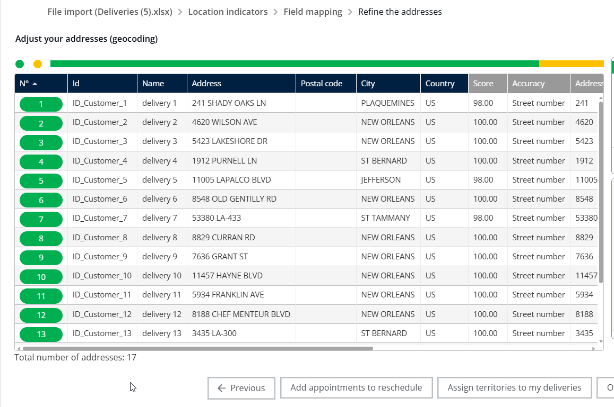

# Import von Lieferungen

## 1. Einführung

Willkommen! Dieser Leitfaden soll den Import Ihrer Lieferdaten in den Server reibungslos und erfolgreich gestalten.

Der Import von Lieferungen ermöglicht es Ihnen, eine Liste von Adressen und Kundeninformationen direkt in das System hochzuladen, um sie anzusehen und die Routen zu optimieren. Wenn Sie diese einfachen Schritte befolgen, ordnen Sie Ihre Tabellenkalkulationsspalten den erforderlichen Systemfeldern zu, visualisieren die Standorte auf einer Karte und beginnen mit der Optimierung Ihrer Lieferwege.

***

## 2. Anfangskonfiguration

#### Aufrufen von "Meine Lieferungen"

Um mit dem Import Ihrer Lieferungen zu beginnen, müssen Sie zunächst navigieren:

1. Vom Hauptmenü zu **Meine Lieferungen**.
2. Sie sind nun bereit, Ihre **Daten zu importieren.**

#### Herunterladen von Beispieldaten

Wenn Sie unsicher sind, wie Sie Ihre Excel-Datei formatieren sollen, können Sie eine Beispielvorlage herunterladen. Die Verwendung der Beispieldaten stellt sicher, dass Ihre Datei sofort importbereit ist.

1. Klicken Sie auf **Herunterladen**.
2. Die Excel-Datei mit Beispieldaten wird heruntergeladen.

<figure><figcaption></figcaption></figure>

<figure><figcaption></figcaption></figure>

💡 **Tipp** : Verwenden Sie immer die bereitgestellten Beispieldaten, wenn Sie neu in der Systemstruktur sind. Dies reduziert häufig spätere Zuordnungsfehler!

***

## 3. Funktionsbeschreibungen mit Vorteilen

Der Importprozess umfasst mehrere wichtige Schritte, die sicherstellen helfen, dass Ihre Daten genau für die Routenplanung vorbereitet sind:

| Funktion                | Kontext und Nutzen                                                                                                                                                                                                                                                       |
| ----------------------- | ------------------------------------------------------------------------------------------------------------------------------------------------------------------------------------------------------------------------------------------------------------------------ |
| **Datenzuordnung**      | Dies stellt sicher, dass die Spaltenüberschriften in Ihrer hochgeladenen Tabellenkalkulation (wie "Cust ID" oder "Client Name") korrekt den Feldern zugeordnet werden, die der Server verwendet. Diese genaue Zuordnung ist entscheidend für eine präzise Routenplanung. |
| **Geokodierungsfarben** | Nach dem Import versucht das System automatisch, den genauen Standort (Geocode) jeder Lieferadresse zu ermitteln. Farben zeigen Erfolg oder Misserfolg an, sodass Sie Fehler schnell erkennen und korrigieren können.                                                    |
| **Routenoptimierung**   | Dies ist der letzte Schritt, bei dem das System die effizienteste Reihenfolge und Strecke für Ihre importierten Lieferungen berechnet.                                                                                                                                   |

## 4. Lieferungen importieren und Routen optimieren

Diese Aufgabe umfasst den Prozess des Hochladens Ihrer Lieferdaten, der Überprüfung der Feldzuordnung und des Startens der Routenplanung.

#### Daten importieren und Felder zuordnen

Sie müssen dem System mitteilen, welche Spalten in Ihrer Tabellenkalkulation den Feldern des Systems entsprechen (z. B. Kunden-ID oder Name).

1. Klicken Sie auf **importieren** um den Prozess des Imports Ihrer Lieferdaten in den Server zu starten

<figure><figcaption></figcaption></figure>

2. Ein Zuordnungsfenster erscheint und fordert Sie auf, Ihre Excel-Felder den erforderlichen Serverfeldern zuzuordnen.
3. Wenn ein Feld bereits korrekt zugeordnet ist (wie dies der Fall ist, wenn Sie die Vorlage verwenden), können Sie die Zuordnung für dieses Feld überspringen.

**Um eine Feldzuordnung zurückzusetzen oder anzupassen (am Beispiel Kunden-ID und Name):**

4. Wenn ein Feld derzeit zugeordnet ist, können Sie wählen, es zu ignorieren.
5. Klicken Sie _ignoriert_ um das Feld einer anderen Einschränkung von TourSolver zuzuordnen.

<figure><figcaption></figcaption></figure>

<figure><figcaption></figcaption></figure>

6. Klicken Sie auf **alle anzeigen** um alle möglichen Feldoptionen anzuzeigen.

<figure><figcaption></figcaption></figure>

7. Klicken Sie auf das **Kunden-ID** Option, um es zuzuordnen.

<figure><figcaption></figcaption></figure>

8. Wenn Sie das Namensfeld ändern müssen, klicken Sie unter der aktuellen Namenszuordnung auf ignorieren.

<figure><figcaption></figcaption></figure>

9. Klicken Sie auf **Name** um die Zuordnung für das Namensfeld abzuschließen

<figure><figcaption></figcaption></figure>

#### Daten prüfen und Geokodierungsergebnisse

Nachdem Sie die Datenzuordnung bestätigt haben, können Sie zur Kartenansicht wechseln, um die Geokodierungsergebnisse zu überprüfen.

1. Klicken Sie auf **Weiter** sobald die Zuordnung abgeschlossen ist

<figure><figcaption></figcaption></figure>

2. Die Kartenansicht erscheint und zeigt Ihre Standorte mit Geokodierungsfarben an

<figure><figcaption></figcaption></figure>

3. Überprüfen Sie den **Standorte** und deren **Farben**.
4. Wenn Sie graue Standorte sehen, wurden diese Adressen vom System nicht gefunden. Möglicherweise müssen Sie diese Adressen in Ihren Originaldaten überprüfen und korrigieren, bevor Sie die Route zur besseren Genauigkeit optimieren

<figure><figcaption></figcaption></figure>

5. Klicken Sie auf **Meine Routen optimieren** um mit der Routenberechnung zu beginnen

<figure><figcaption></figcaption></figure>

6. Sobald Sie **die Optimierung starten**, beginnt das System mit dem Berechnungsprozess.

<figure><figcaption></figcaption></figure>

## 5. Geokodierungsstatus verstehen

Wenn die Kartenansicht erscheint, helfen Ihnen Farben zu verstehen, ob Ihre Adressen erfolgreich lokalisiert (geokodiert) wurden:

* **Gelbe Farbe** zeigt an, dass der Standort erfolgreich auf Straßenebene geokodiert wurde.

<figure><figcaption></figcaption></figure>

* Grüne Farbe zeigt an, dass der Standort erfolgreich auf Gebäudeebene geokodiert wurde.

<figure><figcaption></figcaption></figure>

<figure><figcaption></figcaption></figure>

* **Graue Farbe** zeigt an, dass der Standort nicht geokodiert wurde.

<figure><figcaption></figcaption></figure>

<figure><figcaption></figcaption></figure>

***

## 6. Produktivitätstipps

Hier sind einige Möglichkeiten, Ihren Datenimport schneller und genauer zu machen:

* 💡 **Priorisieren Sie Gelb:** Wenn Sie die Kartenansicht überprüfen, wissen Sie, dass gelbe Standorte zuverlässig sind (auf Straßen geokodiert). Konzentrieren Sie Ihre Aufmerksamkeit auf alle Standorte, die als **Grau**.
* 💡 **Markieren Sie effizientes Zuordnen:** Wenn Sie schnell ändern müssen, wie ein Feld zugeordnet ist, denken Sie daran, dass Sie wählen können, **ignorieren** die aktuelle Zuordnung und dann sofort den richtigen Feldnamen auswählen. Das ist schneller, als die Daten in Ihrer Tabellenkalkulation außerhalb des Systems zu korrigieren.
