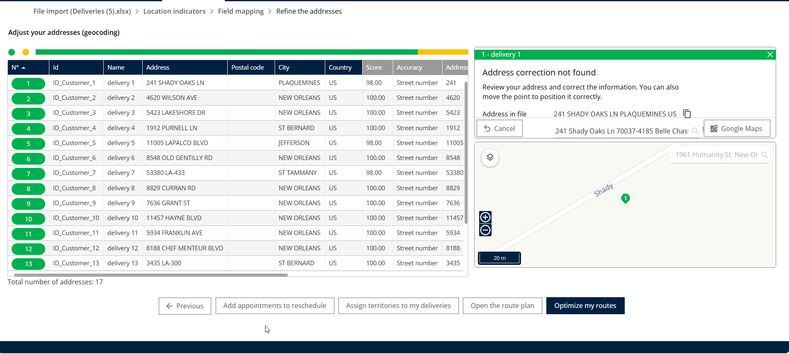

# Adresse einer Lieferung ändern

## 1. Einführung

Willkommen! Diese Anleitung zeigt Ihnen genau, wie Sie die Adresse einer bestehenden Lieferung aktualisieren und sicherstellen, dass Ihre Routen sofort aktualisiert werden.

## 2. Anfangskonfiguration

* **Benachrichtigungseinstellungen festlegen**
  * Schalten Sie das **Benachrichtigungsumschaltfeld** ein, damit Kunden eine SMS/E-Mail erhalten, wenn eine Adresse geändert wird.
* **Sicherstellen der Datenrichtigkeit**
  * Geben Sie Kundentelefonnummern in **internationalen Format** ein und verwenden Sie das **Bezirksspalte** um die Geokodierungsgenauigkeit nach Änderungen zu verbessern.

## 3. Funktionsbeschreibungen und Vorteile

Der Hauptvorteil der Adressänderungsfunktion besteht darin, dass sie eine genaue und effiziente Zustellroute gewährleistet, wenn sich Daten ändern.

<table data-header-hidden><thead><tr><th valign="top"></th><th valign="top"></th></tr></thead><tbody><tr><td valign="top">Funktion</td><td valign="top">Kontext und Nutzen</td></tr><tr><td valign="top">Adressänderung</td><td valign="top">Ermöglicht es Ihnen, den Standort einer bestimmten Lieferung schnell zu korrigieren oder zu aktualisieren, indem Sie das Adressfeld verwenden</td></tr><tr><td valign="top">Neuoptimierung</td><td valign="top">Sobald Sie die neue Adresse speichern, berechnet das System die optimale Route automatisch neu. Das bedeutet, dass die neue Entfernung und die Fahrzeit nach der Neuoptimierung sofort neu berechnet werden.</td></tr></tbody></table>

## 4. Aktualisieren einer bestehenden Lieferadresse und Neuberechnung der Route

Dieses Verfahren führt Sie durch die Auswahl einer Lieferung, die Aktualisierung ihres Standorts und die Durchführung einer Neuoptimierung, um die neue Route anzuzeigen.

**Zugriff auf den Optimierungsbildschirm**

1. Von der **Startseite**, klicken Sie auf **Optimierung**.

<figure><figcaption></figcaption></figure>

**Wählen Sie die zu bearbeitende Lieferung aus**

2. Wählen Sie beliebige Lieferdetails aus.
3. Klicken Sie auf die **Bearbeiten** Schaltfläche.

<figure><figcaption></figcaption></figure>

**Geben Sie die neue Adresse ein**

4. Geben Sie die **neue Adresse** im Adressfeld.

**Neuen Standort finden und bestätigen**

5. Scrollen Sie nach unten.
6. Klicken Sie auf **Suchen Sie**

<figure><figcaption></figcaption></figure>

7. Wählen Sie die **neue Adresse** aus den vorgeschlagenen Optionen aus, die Sie eingegeben haben

<figure><figcaption></figcaption></figure>

**Speichern Sie die Adressänderung**

8. Klicken Sie auf **Bearbeiten**.

<figure><figcaption></figcaption></figure>

**Starten Sie die Neuoptimierung der Route**

9. Klicken Sie auf **Lieferungen**
10. Klicken Sie auf **Optimieren**

<figure><figcaption></figcaption></figure>

**Erwartetes Ergebnis**

Nach dem Speichern und Optimieren sehen Sie sofortige Ergebnisse:

* Die neue Route und die Details werden deutlich auf der Karte angezeigt.
* Das System hat die neue Entfernung und Fahrzeit neu berechnet.

<figure><figcaption></figcaption></figure>

### Alternative Methode: Mehrere Adressen über die _Meine Lieferungen_ Seite

1. Gehen Sie zu **Meine Lieferungen**.
2. Wählen Sie **Lieferungen** um Ihre Bestellliste anzuzeigen.
3. Öffnen Sie die **Adressanpassung** Option auf der Karte.
4. Ändern Sie die Adressen nach Bedarf.

<figure><figcaption></figcaption></figure>

