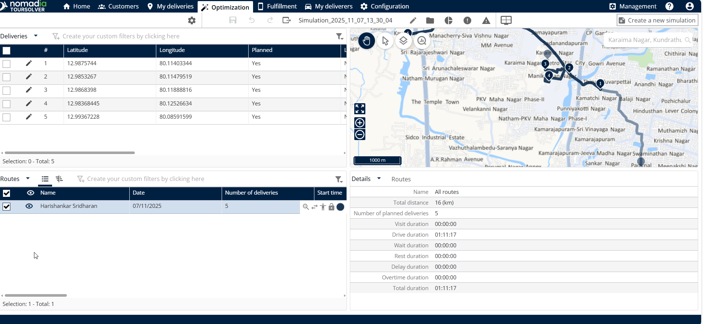
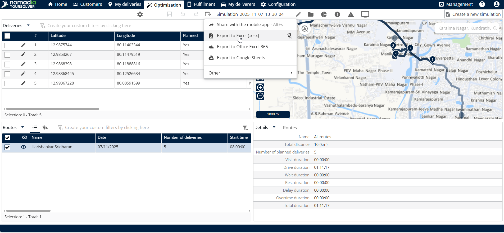
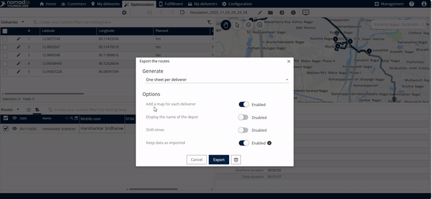
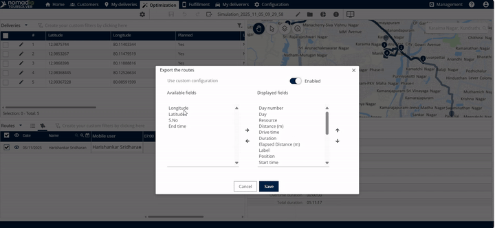
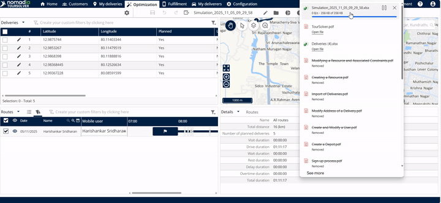
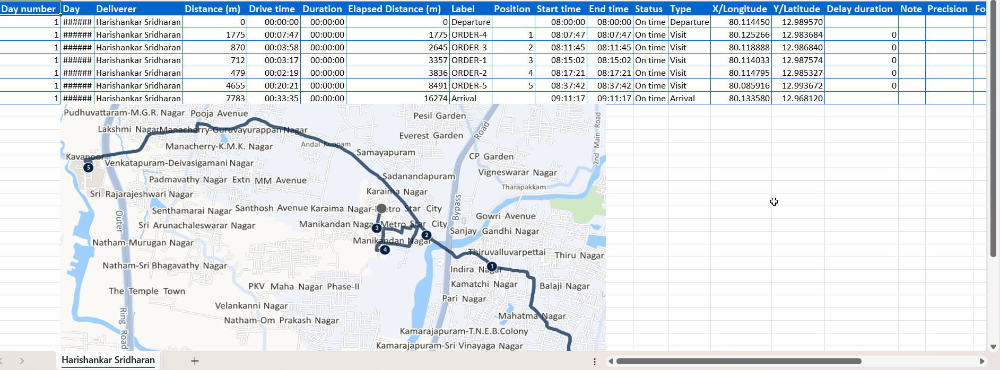

# Meine Routen exportieren

## 1. Einführung

Diese Anleitung zeigt Ihnen, wie Sie abgeschlossene Routen mit dem Routemanagement-System auswählen, anpassen und exportieren. Ob Sie Ergebnisse per Excel an ein Teammitglied weitergeben oder Daten in einen Kalender integrieren möchten – dieser Prozess ist so gestaltet, dass er einfach und effektiv ist.

## 2. Anfangskonfiguration

**Anpassen Ihrer Excel-Export-Einstellungen**

Wenn Sie den Export nach Excel wählen, bietet das System mehrere Optionen zur Anpassung der resultierenden Datei.

1.  **Wählen Sie Ihr Tabellenlayout:** Wählen Sie, wie die Routendaten organisiert werden sollen:

    * **Ein Blatt für alle Zusteller**.
    * **Ein Blatt pro Zusteller**.
    * _**Kontext**:_ Dies hilft Ihnen zu entscheiden, ob Sie eine konsolidierte Ansicht oder detaillierte Berichte für einzelne Teammitglieder wünschen.

    
<figure><figcaption></figcaption></figure>

💡 **Tipp:** Diese Konfigurationen gelten nur für die Excel-Exportoption. Andere Formate (wie PowerPoint oder Kalender) verwenden ihre standardmäßigen Ausgabe-Einstellungen.

2. **Auswählen benutzerdefinierter Felder (Spalten)**

Sie können auswählen, welche spezifischen Spalten (Felder) in Ihrer exportierten Datei erscheinen.

1. Klicken Sie auf **andere** innerhalb des Konfigurationsfensters.
2. Sie sehen eine Liste von **verfügbaren Feldern** und **Anzeige-Feldern**.

<figure><figcaption></figcaption></figure>

3. Sie können auch **die benutzerdefinierte Konfiguration aktivieren** falls erforderlich.

* _Kontext:_ Nach Abschluss enthält die Exportdatei sowohl **Standard- als auch zugeordnete Spalten**.

4. Klicken Sie **Speichern** wenn Sie die Felder angepasst haben.

***

## 3. Funktionsbeschreibungen und Vorteile

Der Hauptvorteil der Routenexport-Funktion ist ihre Flexibilität, die es Ihnen ermöglicht, Daten schnell in Formaten zu teilen, die für verschiedene Beteiligte geeignet sind.

#### Verschiedene Exportziele

Durch Klicken auf die **Exportoption** und Auswahl von **andere**öffnet sich eine große Auswahl an Exporttypen.

| Exportfunktion                                                     | Nutzen/Nützlichkeit                                                                                        |
| ------------------------------------------------------------------ | ---------------------------------------------------------------------------------------------------------- |
| **Export nach Excel**                                              | Ideal für detaillierte Datenanalysen, Berechnungen und strukturierte Berichterstattung.                    |
| **Export nach PowerPoint / Office 365 PowerPoint / Google Slides** | Nützlich, um schnell Präsentationen oder Zusammenfassungen für Meetings zu erstellen.                      |
| **Export in den Kalender (Office Outlook / Google)**               | Ermöglicht die direkte Integration von Routenzeiten und -plänen in persönliche oder Team-Kalender.         |
| **Exportieren einer Routenübersicht per E-Mail**                   | Teilt effizient einen Überblick über den Routenplan mit den Empfängern.                                    |
| **Export nach Masternaut .GPX / Extended .GPX**                    | Notwendig für die Verwendung mit bestimmten GPS-Navigationssystemen oder fortgeschrittener Kartensoftware. |
| **Export ins KML-Format (Google usw.)**                            | Standardformat zum Anzeigen geospatialer Daten (wie Routen) in Kartentools (z. B. Google Earth).           |
| **Export zu Webhook**                                              | Erleichtert den automatisierten Datentransfer zu anderen Betriebssystemen.                                 |

## 4. Exportieren einer Route nach Excel

Dies ist die häufigste Aufgabe und umfasst das Auswählen der Route, das Bestimmen des Ziels, das Konfigurieren der Einstellungen und das Abschließen des Downloads.

Befolgen Sie diese Schritte, um Ihre ausgewählte Route erfolgreich zu exportieren:

**Optimierungsbereich finden**

1. Starten Sie von der **Startseite**. Klicken Sie auf Optimierung

**Route auswählen**

2. **Klicken Sie die Route an** die Sie exportieren möchten.

<figure><figcaption></figcaption></figure>

3. **Den Exportdialog starten**

**Excel-Format wählen**

4. Da Sie die Daten in Excel exportieren möchten, klicken Sie auf **Export nach Excel**.

<figure><figcaption></figcaption></figure>

**Datei konfigurieren und erzeugen**

5. Überprüfen und passen Sie Ihre initialen Konfigurationseinstellungen (Tabellenlayout, Zeitangaben, Datenintegrität) wie in Abschnitt 2 beschrieben an.

<figure><figcaption></figcaption></figure>

6. Wenn Sie Felder angepasst haben, stellen Sie sicher, dass Sie auf geklickt haben **Speichern**.

<figure><figcaption></figcaption></figure>

**Export abschließen und Datei öffnen**

7. Klicken Sie auf die **heruntergeladene Datei** um sie zu öffnen

<figure><figcaption></figcaption></figure>

8. Bitte finden Sie die **heruntergeladene Excel-Datei** unten.

<figure><figcaption></figcaption></figure>

***

## 5. Produktivitätstipps

Hier sind einige Möglichkeiten, den Routenexport-Prozess effizienter zu gestalten:

* **Spalten für Effizienz anpassen (Daten filtern):** Wenn Sie für eine schnelle Analyse nur zwei oder drei spezifische Datenpunkte benötigen, verwenden Sie die **andere** Option im Konfigurationsmenü, um unnötige Felder zu entfernen. Dadurch bleibt Ihr Bericht sauber und fokussiert, sodass die Exportdatei nur die **Standard- als auch zugeordnete Spalten** enthält, die am wichtigsten sind.
* **Kalender-Export für die Terminplanung nutzen:** Anstatt komplexe Daten zu exportieren, verwenden Sie die **Export in den Kalender** Option (Office Outlook oder Google), um Zustellern schnell ihre endgültigen Schichtzeiten und Routen-Termine bereitzustellen und so die tägliche Logistik zu vereinfachen.
* **Konfigurationszeit sparen:** Sobald Sie Ihr gewünschtes Tabellenlayout und die Feldauswahl eingerichtet haben (z. B. das Erzeugen von **ein Blatt pro Zusteller** oder das Einschließen von **Schichtzeiten**), klicken Sie auf **Speichern**. Dies ermöglicht es Ihnen, den Export künftig schnell auszuführen, ohne alle detaillierten Einstellungen erneut auswählen zu müssen.
