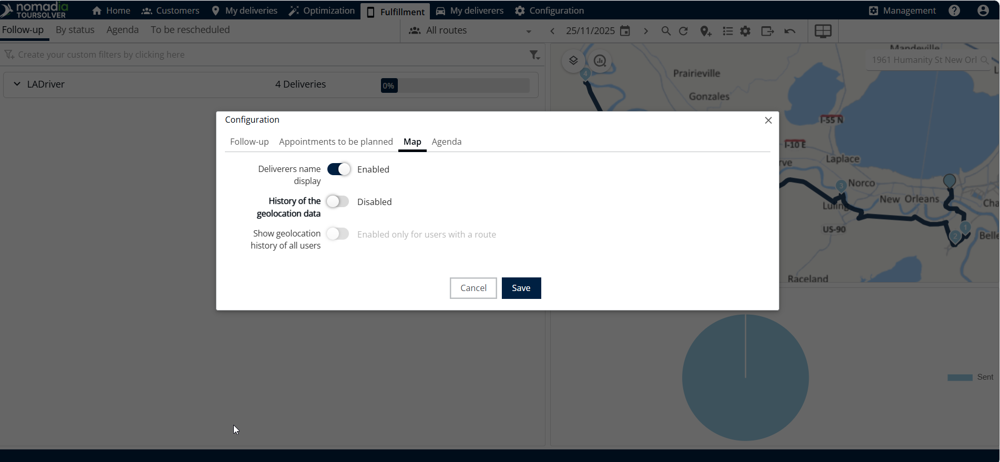

# Wie kann ich meine Zusteller geolokalisieren?

## 1. Einleitung

Die Fähigkeit, Ihr Zustellteam in Echtzeit zu lokalisieren, ist für ein effektives Ressourcenmanagement entscheidend. Dieser Leitfaden vereinfacht den Prozess, die erforderlichen Zugriffsrechte zu aktivieren und die Einstellungen der mobilen Anwendung zu konfigurieren, damit Sie Ihre Zustellmitarbeiter ganz einfach verfolgen können.

## 2. Anfangskonfiguration

Bevor Sie beginnen, geht das System davon aus, dass Sie die Zustellmitarbeiter und ihre geplanten Routen bereits eingerichtet haben. Wenn diese Schritte nicht abgeschlossen sind, müssen Sie zuerst die Zustellung, die Zustellmitarbeiter und die Route erstellen.

### Systemanforderungen (Zugriffskonfiguration)

Um ein erfolgreiches Tracking zu gewährleisten, müssen Ihre Zustellmitarbeiter die richtigen Berechtigungen und den aktivierten Zugriff sowohl für die Webplattform als auch für die mobile Anwendung haben.

**Voraussetzende Aktion**

| Zugriffsart                         | Beschreibung                                                                     |
| ----------------------------------- | -------------------------------------------------------------------------------- |
| **Zusteller- & Routen-Einrichtung** | Der Zustellmitarbeiter und seine zugewiesene Route müssen bereits erstellt sein. |
| **Webzugang**                       | Erforderlich für die Anmeldung im System.                                        |
| **Mobiler Zugriff**                 | Benötigt für die Nutzung der mobilen App, die das Tracking erleichtert.          |

## 3. Funktionsbeschreibungen und Vorteile

Das System bietet wichtige Funktionen, die Ihnen helfen, Sicherheit, Berechtigungen und Tracking-Sichtbarkeit zu verwalten:

* **Rollen- und Berechtigungsverwaltung**: Hier vergeben Sie Ihren Zustellmitarbeitern die notwendigen Berechtigungen zur Nutzung des Systems.
* **Konfiguration der mobilen App**: In diesem Abschnitt können Sie feinabstimmen, wie die mobile App mit dem System kommuniziert, einschließlich Synchronisationsgeschwindigkeit und Agenda-Sichtbarkeit.
* **Datenschutzeinstellungen**(**DSGVO-Konformität**): Sie haben die Möglichkeit zu begrenzen, wann das Tracking stattfindet, und damit den Datenschutzbestimmungen zu entsprechen. Dies schafft Vertrauen und stellt die rechtliche Konformität sicher, indem die Geolokalisierung nur auf Arbeitszeiten und -tage beschränkt wird.

## 4. Aktivierung der Geolokalisierungsverfolgung

### Konfigurieren Sie die mobile App

**Allgemeine Einstellungen bearbeiten.**&#x20;

1. Anzahl der in der Agenda erreichbaren Tage
2. Automatische Synchronisationshäufigkeit
3. Reisezeitinfo anzeigen

4. **Datenschutzregeln festlegen**: Aktivieren Sie in der Konfiguration der mobilen App den Datenschutz entsprechend den relevanten Vorschriften (z. B. DSGVO).

⚠ **Warnung**: Wenn Sie in einer Region mit strengen Datenschutzgesetzen (wie der DSGVO) tätig sind, stellen Sie sicher, dass Sie das Tracking nur während der Arbeitszeiten und an Arbeitstagen aktivieren, um konform zu bleiben.

### Anzeigen der Geolokalisierung im Erfüllungs-Tab

1. Sobald die Konfiguration abgeschlossen ist, können Sie die Tracking-Ansicht im Erfüllungs-Tab aufrufen
2. **Datum auswählen**: Geben Sie das spezifische Datum ein, das für die Route, die Sie verfolgen möchten, geplant ist.

>)

3. **Anzeigeeinstellungen öffnen**: Klicken Sie auf **Einstellungen**.
4. **Tracking-Ansicht ändern**: Hier können Sie anpassen, wie die Tracking-Informationen angezeigt werden: **Verfügbare Felder, Anzeigefelder, zu planende Termine, Karte und Agenda**

<figure><figcaption></figcaption></figure>

3. Klicken Sie auf die Karte, um den Geolokalisierungsverlauf zu aktivieren und anzuzeigen.

<figure><figcaption></figcaption></figure>

## 5. Produktivitätstipps

Hier einige Tipps, um die Nutzung der Tracking-Funktion zu maximieren:

* **Passen Sie Ihre Ansicht an**: Verwenden Sie das Einstellungsmenü im Erfüllungs-Tab, um zu ändern, was auf dem Bildschirm angezeigt wird. Wenn Sie nur Standortverfolgung benötigen, stellen Sie sicher, dass die **Karte** und **Agenda** Ansichten aktiviert sind.
* **Reisezeit überwachen**: Stellen Sie sicher, dass Sie die Konfiguration der mobilen App überprüfen, um **Reisezeitinfo anzeigen**. Dies hilft Ihnen, Ankunftszeiten genau vorherzusagen und Erwartungen zu managen.
* **Häufige Synchronisation beibehalten**: Wenn Echtzeit-Tracking kritisch ist, prüfen Sie die **Automatische Synchronisationshäufigkeit** Einstellung in der Konfiguration der mobilen App. Eine höhere Häufigkeit liefert unmittelbarere Standortaktualisierungen.
