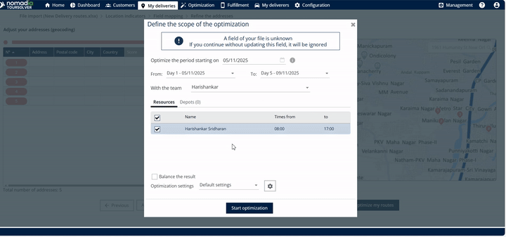
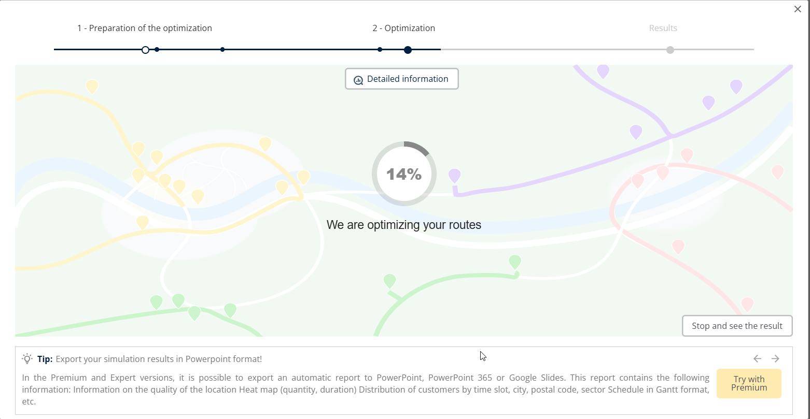
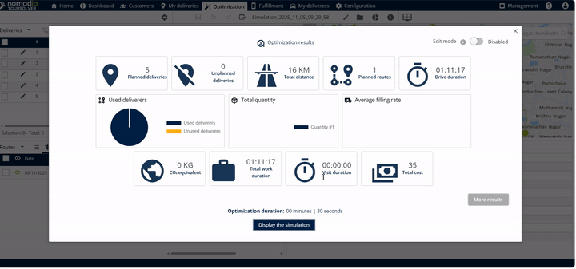
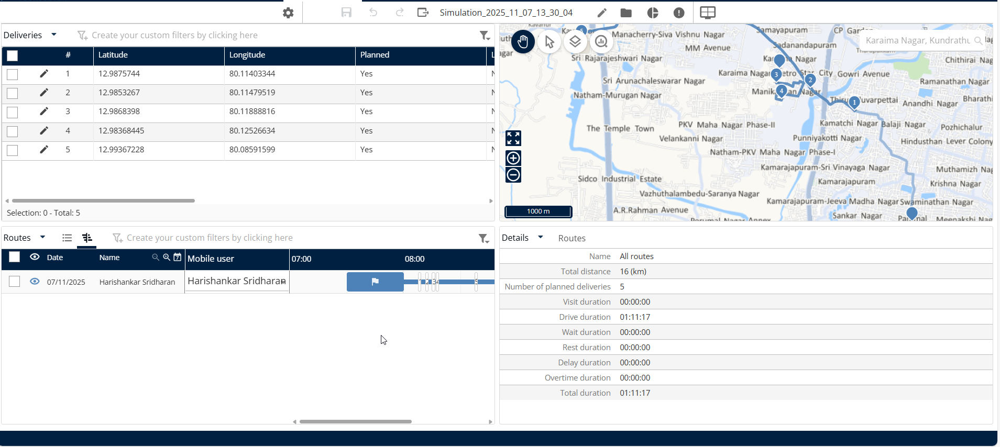
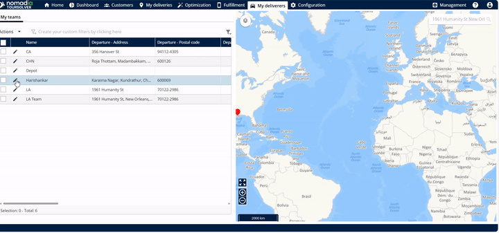
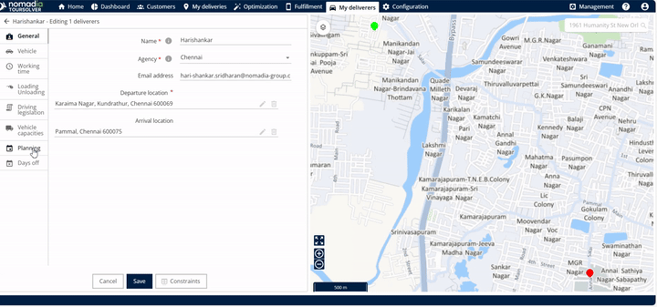
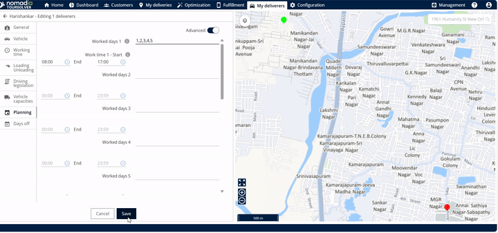

# Optimieren Sie Ihre Lieferungen

## 1. Einführung

Das **Optimieren Ihrer Zustellungen** Funktion rationalisiert Ihre Abläufe, indem sie die bestmögliche Lieferreihenfolge und -routen berechnet. Mit diesem Leitfaden erfahren Sie, wie Sie Ihre Optimierungseinstellungen festlegen und den Routenplanungsprozess erfolgreich starten.

***

## 2. Erste Konfiguration

Um die Optimierungsfunktion zu nutzen, wird vorausgesetzt, dass Sie Ihre Lieferdaten bereits in das System importiert haben.

Bevor Sie mit der Optimierung beginnen können, müssen Sie zum Startpunkt des Prozesses navigieren.

1. Navigieren Sie zu **Meine Lieferungen**.
2. Nachdem Sie sichergestellt haben, dass die Lieferungen importiert sind, klicken Sie **Weiter**.
3. Klicken Sie auf **Meine Routen optimieren**.

***

## 3. Funktionen und Vorteile

Das **Optimieren Ihrer Zustellungen** bietet zwei Hauptanpassungsfunktionen, die Ihnen die Kontrolle darüber geben, wie Routen geplant werden:

* **Routenoptimierung:** Diese Kernfunktion nimmt alle Ihre importierten Lieferungen und berechnet den effizientesten Routenterminplan.
  * **Vorteil:** Erfolgreich optimierte Lieferungen, die eine effiziente Nutzung von Zeit und Ressourcen gewährleisten.
* **Bearbeitbare Optimierungsdaten:** Sie können genau angeben, wann die optimierten Routen gestartet werden sollen, indem Sie das Start- und Enddatum eingeben oder bearbeiten.
* **Bearbeitbare Planungstage:** Sie können die Anzahl der Tage anpassen, für die das System planen soll. Dies ist nützlich, wenn sich Ihre betrieblichen Anforderungen ändern.

## 4. Start der Routenoptimierung

Diese Aufgabe führt Sie durch die Auswahl des Zeitrahmens und das Starten des Routenkalkulationsprozesses.

1. **Legen Sie den Optimierungszeitraum fest:** Geben Sie auf dem Optimierungsbildschirm das gewünschte Start- und Enddatum für die optimierten Routen ein oder bearbeiten Sie es.
2. **Anpassen der Anzahl der Tage (optional):** Falls erforderlich, können Sie die Anzahl der Planungstage direkt auf diesem Bildschirm anpassen.

<figure><figcaption></figcaption></figure>

3. Klicken Sie auf **Optimierung starten**

<figure><figcaption></figcaption></figure>

#### Anzeigen der Optimierungsergebnisse

1. Klicken Sie auf Optimierung starten

<figure><figcaption></figcaption></figure>

2. Sobald die Optimierung läuft, können Sie die Ergebnisse überwachen.

<figure><figcaption></figcaption></figure>

**Ergebnisse überprüfen:** Sie sehen die Zusammenfassung der Optimierungsergebnisse.

3. Klicken Sie auf **Die Simulation anzeigen**

<figure><figcaption></figcaption></figure>

4. Die Lieferungen wurden erfolgreich optimiert.

<figure><figcaption></figcaption></figure>

#### Anpassen des Planungszeitraums (Anzahl der Tage)

Wenn Sie ändern müssen, für wie viele Tage das System Routen planen soll, können Sie diese Einstellung in **Meine Zusteller**.

1. Gehen Sie zu **Meine Zusteller**
2. Suchen Sie die Ressource, die mit der Lieferung verknüpft ist.

<figure><figcaption></figcaption></figure>

3. Klicken Sie auf **Planung**

<figure><figcaption></figcaption></figure>

3. **Tage bearbeiten:** Ändern Sie den Wert auf die neue Anzahl von Tagen, die Sie für die Planung verwenden möchten.
4. Klicken Sie auf **Speichern**

<figure><figcaption></figcaption></figure>

## 5. Produktivitätstipps

* ⏳ **Tipp: Bei großen Aufgaben Geduld haben:** Wenn Sie viele Lieferungen zur Optimierung haben, kann der Prozess länger dauern als erwartet. Das ist normal, da das System komplexe Berechnungen durchführt.
* ✅ **Tipp: Ergebnisse frühzeitig prüfen:** Sie müssen nicht immer auf das komplette Ende des Prozesses warten. Wenn Sie schnell ein vorläufiges Ergebnis benötigen, können Sie klicken **Stopp und Ergebnis anzeigen** jederzeit während der Berechnung.
* 🎉 **Erfolgsbestätigung:** Sobald das System bestätigt, dass „Die Lieferungen wurden erfolgreich optimiert“, wissen Sie, dass Ihre neuen Routen einsatzbereit sind.
