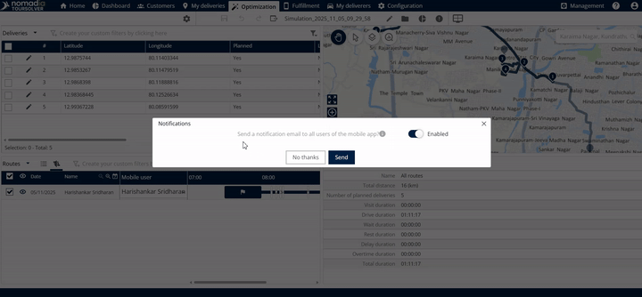
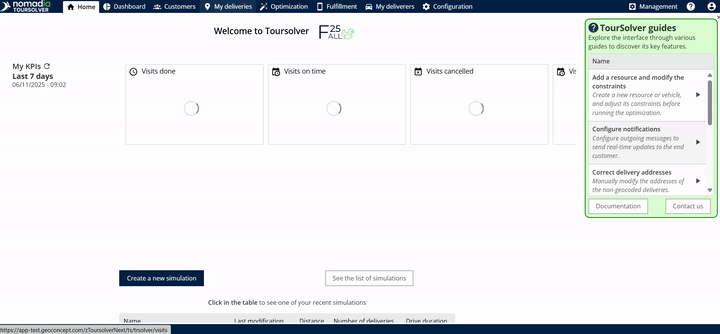
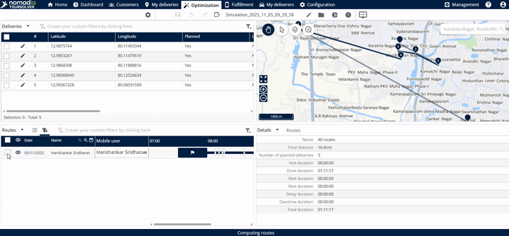
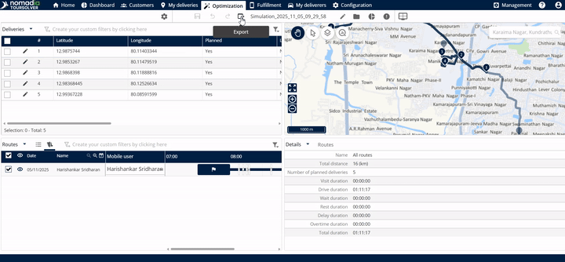
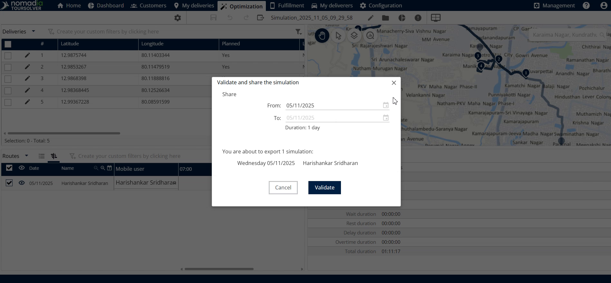
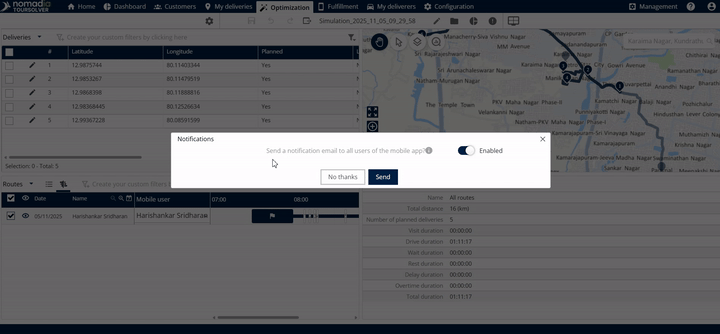
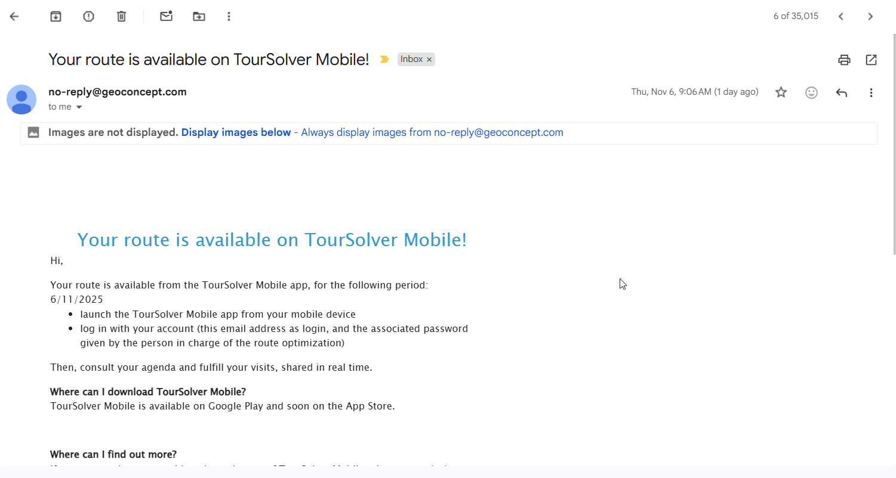

# Eine Tour mit der mobilen App teilen

## 1. Einführung

Dieser Leitfaden führt Sie durch den Prozess, eine geplante Route an die mobile Anwendung Ihres Außendienstteams zu exportieren. Dieser Vorgang stellt sicher, dass mobile Benutzer eine E-Mail- oder SMS-Benachrichtigung mit der geteilten Tour und den zugehörigen Lieferungen erhalten.

## 2. Anfangskonfiguration

Um eine Tour erfolgreich zu teilen, müssen Sie zuerst den Optimierungsbereich aufrufen und eine abgeschlossene Route auswählen.

| Kontotyp               | Benachrichtigung gesendet | Inhalt gesendet                                                                        |
| ---------------------- | ------------------------- | -------------------------------------------------------------------------------------- |
| **Testversion**        | SMS-Benachrichtigung      | Link zum Herunterladen der mobilen Anwendung                                           |
| **Abonnierte Version** | Benachrichtigungs-E-Mail  | Benachrichtigung an alle ausgewählten Mobile-App-Benutzer, dass die Tour geteilt wurde |

## 3. Funktionsbeschreibungen mit Vorteilen

Das **Mit der mobilen App teilen** Funktion ist entscheidend, um Ihre Planungsaktivitäten mit der realen Ausführung zu verbinden.

* **Nahtloser Routenübertrag:** Übertragen Sie komplexe, optimierte Routen (Touren) mühelos direkt auf das mobile Gerät, wo sie benötigt werden.
* **Datumsspezifisches Teilen:** Sie können den genauen Datumsbereich steuern, für den die Tour in der mobilen App aktiv und zugänglich ist. Das Teilen einer Tour für einen bestimmten Datumsbereich (z. B. Dauer 1 Tag) legt genau fest, welche Lieferungen an den ausgewählten Tagen ausgeführt werden sollen.
* **Bestätigungs-Feedback:** Das System bietet klare Rückmeldungen darüber, wie viele Lieferungen geteilt werden und wie viele Benachrichtigungen an mobile Benutzer gesendet werden.

## 4. Verständnis von Benachrichtigungen

Nachdem Sie die Tour geteilt haben, bestimmt das System, wie Benachrichtigungen basierend auf Ihren Kontoeinstellungen zugestellt werden.

<figure><figcaption></figcaption></figure>

## 5. Eine Tour teilen

Befolgen Sie diese detaillierten Schritte, um Ihre optimierte Route erfolgreich mit Ihren mobilen Benutzern zu teilen.

### Exportieren und Teilen einer optimierten Tour

1. Klicken Sie auf **Optimierung**

<figure><figcaption></figcaption></figure>

2. Wählen Sie die **gewünschte Route** aus der Liste

<figure><figcaption></figcaption></figure>

3. Klicken Sie auf **Exportieren** und klicken Sie auf **Mit der mobilen App teilen**

<figure><figcaption></figcaption></figure>

4. **Startdatum festlegen (Von-Datum):** Geben Sie das Startdatum ein, ab dem die Tour geteilt werden soll.
5. Wählen Sie ein **Gewünschtes Startdatum**
6. **Enddatum festlegen (Bis-Datum):** Wählen Sie ein "**bis-Datum**".

<figure><figcaption></figcaption></figure>

**Hinweis**: Die Standarddauer beträgt 1 Tag, aber Sie können das "bis-Datum" bei Bedarf anpassen, um mehrtägige Routen zu erstellen.\
Datums-Auswahloberfläche, die Von-Datum, Bis-Datum und Dauer (1 Tag) anzeigt

<figure><figcaption></figcaption></figure>

7. **Überprüfen Sie die Benachrichtigung (Test/Abonniert):** Lesen Sie die Bestätigungsbenachrichtigung, die angezeigt wird, je nachdem, ob Sie eine Test- oder eine abonnierte Version verwenden.
8. Klicken Sie auf **Senden**

<figure><figcaption></figcaption></figure>

&#x20;**Erwartetes Ergebnis**: Endgültiges Bestätigungs-Popup mit Details zu geteilten Lieferungen und gesendeten E-Mails

<figure><figcaption></figcaption></figure>

## 6. Produktivitätstipp

* **Tipp: Überprüfen Sie die Anzahl der Lieferungen:** Achten Sie stets genau auf die Abschlussbenachrichtigung, die erscheint, wenn Sie auf **senden** Diese Nachricht bestätigt genau, wie viele Lieferungen in der Tour enthalten sind, die Sie teilen, und wie viele E-Mails an Ihre mobilen Benutzer gesendet werden.
