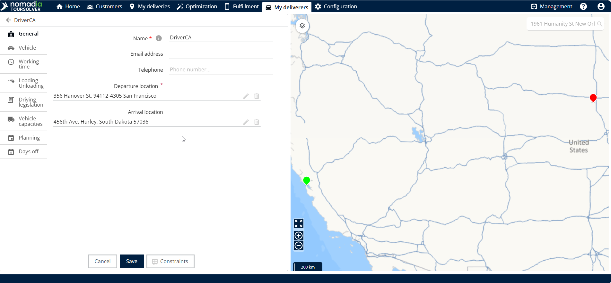
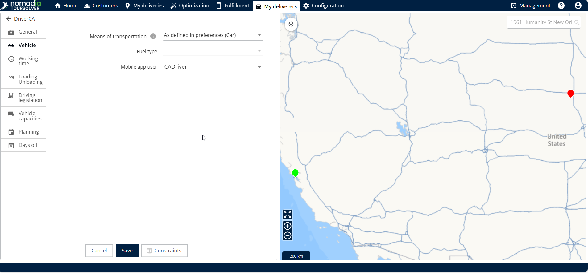
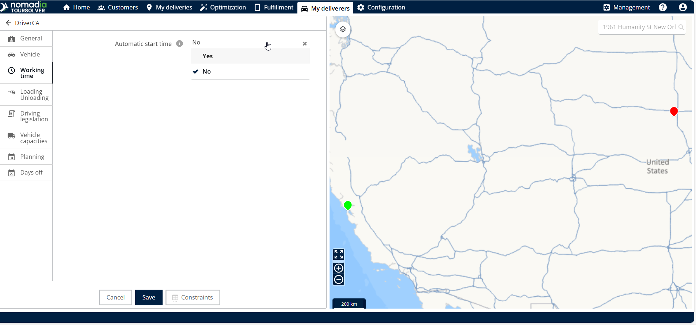
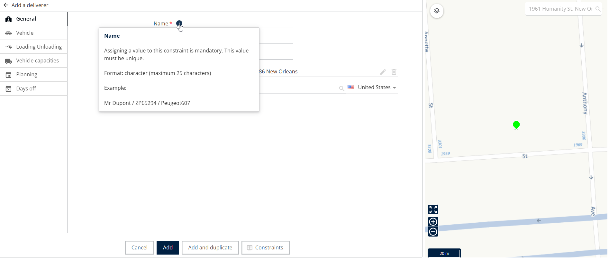

# Erstellung einer Ressource

## 1. Einführung

Willkommen! Dieser Leitfaden führt Sie durch die einfachen Schritte zur Definition einer Ressource, wie z. B. eines Zustellmitarbeiters oder Fahrers—innerhalb von TourSolver. Unser Ziel ist es, sicherzustellen, dass Sie Ihre Teammitglieder genau und mit Vertrauen einrichten können, damit das System Fahrzeugzuweisungen, Arbeitspläne und freie Tage effektiv verwaltet.

## 2. Anfangskonfiguration

Um mit der Definition eines neuen Ressourcenprofils zu beginnen:

1. Gehen Sie zum **Ressourcen-Seite.**
2. Klicken Sie auf **Hinzufügen** befindet sich im Aktionen-Menü.

<figure><figcaption></figcaption></figure>

## 3. Funktionsbeschreibungen und Vorteile

* Das Erstellen einer Ressource umfasst das Ausfüllen mehrerer Registerkarten, die definieren, wie Ihr Mitarbeiter arbeitet, sich fortbewegt und wann er verfügbar ist.
* **Ressourcendetails (Allgemeine Infos**): Hier identifizieren Sie das Teammitglied mit Namen und geben dessen Startpunkt an, der als Abfahrtsort bekannt ist.
* **Fahrzeuge-Registerkarte**: Hier definieren Sie die primäre Art, wie sich das Teammitglied fortbewegt, indem Sie das Transportmittel auswählen.
* **Fahrzeugkapazitäten-Registerkarte**: Dieser Abschnitt ist entscheidend, um festzulegen, was die Ressource (oder ihr zugewiesenes Fahrzeug) transportieren kann. Sie können Fahrzeugkapazitäten hinzufügen, um sicherzustellen, dass bei der Planung Einschränkungen eingehalten werden.
* **Arbeitszeit- und Planungs-Registerkarten**: Diese Abschnitte definieren die Verfügbarkeit des Mitarbeiters, einschließlich der Auswahl, ob die automatische Startzeitfunktion aktiv ist, der Festlegung konkreter Arbeitszeiträume und der Planung von Mittagspausen.
* **Tage-frei-Registerkarte**: Damit können Sie bestimmte Daten planen, an denen die Ressource nicht verfügbar sein wird

💡 Tipp: Wenn Sie sich beim Ausfüllen eines bestimmten Feldes oder einer Einschränkung unsicher sind, können Sie über die Tooltip-Symbole fahren, um eine Erklärung zu erhalten. Jeder Tooltip bietet eine kurze Erläuterung dessen, was diese Einschränkung steuert.

## 4. Ressourcenerstellung

Befolgen Sie diese Schritte, um Ihren neuen Zustellmitarbeiter oder Fahrer erfolgreich zu erstellen und zu definieren.

1. Geben Sie die **voller Ressourcenname**.
2. Geben Sie die **Abfahrtsort** (wo die Ressource ihre Schicht beginnt).

<figure><figcaption></figcaption></figure>

3. Gehen Sie zum **Fahrzeuge-Registerkarte.**
4. Wählen Sie die **Transportmittel** (z. B. Auto, Fahrrad, Lkw).

<figure><figcaption></figcaption></figure>

5. Gehen Sie zum **Arbeitszeit-Registerkarte.**
6. Wählen Sie, ob Sie möchten, dass die automatische Startzeitfunktion aktiv ist (ja oder nein).

<figure><figcaption></figcaption></figure>

### Festlegen von Fahrzeugkapazitäten

Wenn Ihre Ressource Güter transportiert, müssen Sie deren Kapazitätsgrenzen definieren:

1. Gehen Sie zum **Fahrzeugkapazitäten-Registerkarte**.
2. Klicken Sie auf das Plus-Symbol **(+)** in der unteren Ecke.
3. Fügen Sie die benötigten Fahrzeugkapazitäten in die verfügbaren Felder ein.

<figure><figcaption></figcaption></figure>

**Um einen Kapazitätsplatz zu löschen:** Wenn Sie einen Kapazitätseintrag entfernen müssen, klicken Sie auf das Löschsymbol auf der rechten Seite.

### Verwaltung von Arbeitsplänen (Planung)

Die Planungs-Registerkarte ermöglicht es Ihnen, die konkreten Arbeitszeiträume und Pausen für die Ressource festzulegen.

#### Um Arbeitszeiträume hinzuzufügen/bearbeiten:

1. Gehen Sie zum **Planungs-Registerkarte**.
2. Klicken Sie auf die **Arbeitszeitfenster**.
3. Klicken Sie auf die **Zeiten bearbeiten** Schaltfläche.
4. Fügen Sie die konkreten Arbeitszeiten hinzu und klicken Sie **bearbeiten**.

<figure><figcaption></figcaption></figure>

#### Um Mittagspausen zu verwalten:

1. Um das vorhandene Mittagszeit-Arbeitszeitfenster zu bearbeiten, klicken Sie auf bearbeiten **Mittagspause**.
2. Fügen Sie die **Mittagspausenzeiten hinzu.**
3. Klicken Sie **bearbeiten** um die Änderungen am Mittagszeit-Arbeitszeitfenster zu speichern.
4. Um ein Mittagszeitfenster zu löschen, klicken Sie **Mittagspause löschen**.

<figure><figcaption></figcaption></figure>

### Hinzufügen von freien Tagen

Verwenden Sie die Registerkarte "Tage frei", um geplante freie Zeiten einzutragen:

1. Gehen Sie zum **Freie Tage** Registerkarte.
2. Klicken Sie auf das Plus-Symbol **(+)** auf der rechten Seite, um einen neuen Eintrag hinzuzufügen.
3. Fügen Sie die erforderlichen Zeiträume (Von-Datum/Bis-Datum) hinzu, an denen die Ressource frei sein wird.
4. Klicken Sie auf die **hinzufügen** Symbol, um den Eintrag zu speichern.

⚠ **Warnung**: Beim Festlegen von freien Tagen stellen Sie sicher, dass das "Bis-Datum" (das Enddatum) größer (später) ist als das "Von-Datum" (das Startdatum).

<figure><figcaption></figcaption></figure>

### Abschluss der Ressourcenerstellung

1. Sobald Sie alle notwendigen Details in den verschiedenen Registerkarten ausgefüllt haben. Klicken Sie auf **Hinzufügen**.
2. Die Ressource wird erfolgreich erstellt.

<figure><figcaption></figcaption></figure>

## 5. Produktivitätstipps

Diese Tipps helfen Ihnen, Zeitpläne und Einschränkungen schnell und effizient zu verwalten:

* **Verstehen Sie Einschränkungen**: Wenn Sie unsicher sind, was eine bestimmte Einstellung steuert, nutzen Sie immer die Tooltip-Symbole, indem Sie mit der Maus darüber fahren, um eine kurze Erklärung zu erhalten.

<figure><figcaption></figcaption></figure>

* **Arbeitszeiträume schnell duplizieren**: Wenn eine Ressource mehrere identische Arbeitszeiträume hat, können Sie Zeit sparen, indem Sie die Option zum Duplizieren eines Arbeitszeitfensters anklicken und dann auf Duplizieren klicken, um schnell eine Kopie hinzuzufügen.

<figure><figcaption></figcaption></figure>

* **Verwaltung der Kapazität**: Denken Sie daran, dass Sie unerwünschte Fahrzeugkapazitäten jederzeit löschen können, indem Sie auf das Löschsymbol rechts neben dem Eintrag klicken.
