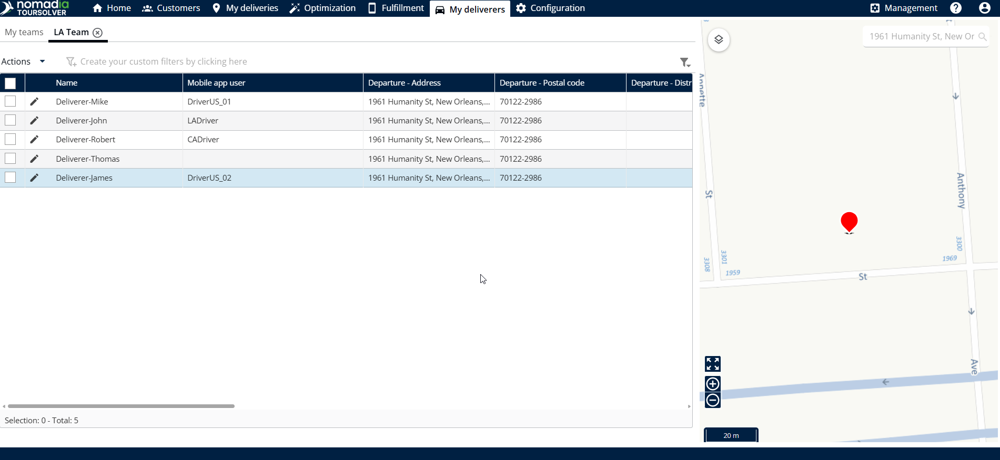
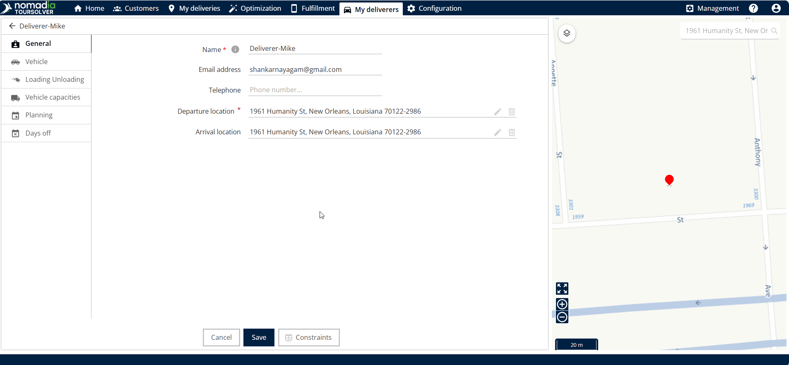
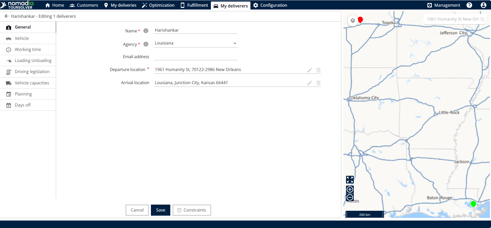
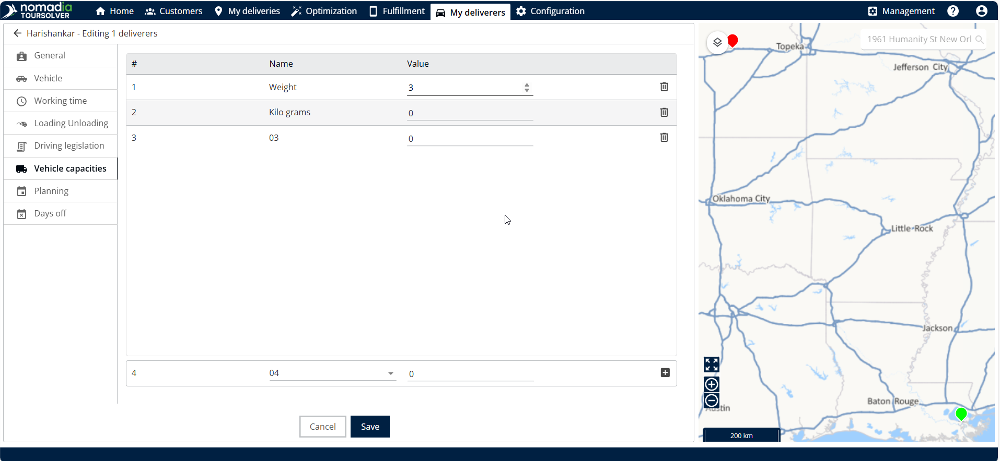
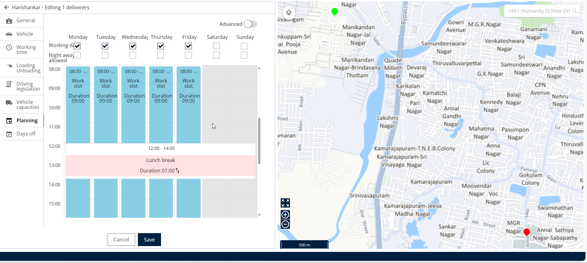
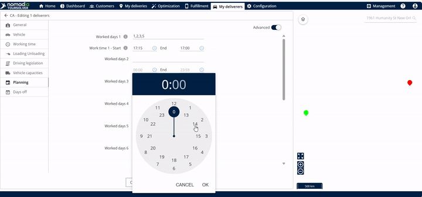
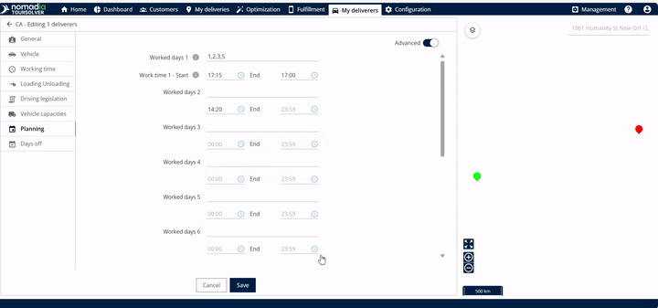

# Ändern einer Ressource und zugehöriger Einschränkungen

## 1. Einführung

Willkommen zu Ihrem Leitfaden für das effiziente Verwalten und Aktualisieren Ihrer Zustellressourcen und deren wichtigen Einschränkungen, oder „Constraints“. Zu wissen, wie man eine Ressource ändert — sei es die Anpassung der Verfügbarkeit eines Teams oder die Änderung der Fahrzeugkapazität einer Person — ist entscheidend für reibungslose Abläufe. In diesem Leitfaden erfahren Sie genau, wie Sie Planung, Standorte und Kapazitäten schnell und erfolgreich ändern.

## 2. Anfangskonfiguration

Sie können damit beginnen, Ressourcen und Constraints direkt von der Startseite des Systems aus zu ändern.

#### Zugriff auf Meine Zusteller

<figure><figcaption></figcaption></figure>

1. **Wählen Sie Ihre Änderungsmethode:** Sie haben zwei hauptsächliche Möglichkeiten, eine Ressource zu ändern: teamweit (eine Gruppe betreffend) oder individuell.
2. Klicken Sie auf die **bearbeiten** (Stift)-Symbol neben dem Namen

<figure><figcaption></figcaption></figure>

3. Sie können beginnen, die zugehörigen Constraints zu ändern.

<figure><figcaption></figcaption></figure>

## 3. Funktionsbeschreibungen und Vorteile

Die Constraints sind die Regeln, die bestimmen, wann, wo und wie eine Ressource arbeitet. Hier sind die gängigsten Constraints erklärt:

* Abfahrts- und Ankunftsort: Diese Einstellung definiert den Start- und Endpunkt des Tages der Ressource. Das Ändern dieser Orte ist wichtig, wenn sich die typische Start- oder Endadresse einer Ressource ändert (z. B. wenn sie von einem anderen Depot aus arbeitet oder nach Hause zurückkehrt).
* Fahrzeugkapazitäten: Hiermit können Sie Grenzen für die Fahrzeugkapazität festlegen, üblicherweise gemessen nach Gewicht. Dies stellt sicher, dass Ihr Lieferfahrzeug nie überladen wird, was bei sicherer und vorschriftsmäßiger Routenplanung hilft. Sie können den Gewichtswert in Kilogramm (kg) oder Gramm (g) angeben.
* Planung (Arbeitszeitslots): Dies legt die Arbeitsverfügbarkeit der Ressource fest. Sie können genaue Start- und Endzeiten verwalten und angeben, an welchen Wochentagen sie verfügbar ist.

**Tipp**: Um mehr über andere Constraints zu erfahren, konsultieren Sie bitte die Constraint-Dokumentation.

## 4. Ändern von Abfahrts- und Ankunftsorten

Sobald Sie den Bildschirm zur Constraint-Bearbeitung aufgerufen haben (mithilfe des Stiftsymbols), folgen Sie den untenstehenden Schritten, um bestimmte Ressourcendetails zu aktualisieren.

Wenn sich der Start- oder Endpunkt einer Ressource ändert, können Sie ihn hier aktualisieren.

1. **Finden Sie die Adresse**: Um den Abfahrts- oder Ankunftsort allgemein zu ändern, suchen Sie den entsprechenden Abschnitt (Abfahrtsort oder Ankunftsort).
2. **Adresse aktualisieren**: Ändern Sie die Abfahrts- und Ankunftsadresse nach Bedarf.

<figure><figcaption></figcaption></figure>

Nach der Änderung sehen Sie die Unterschiede auf der Karte. Die verwendete Farbe wird für den Abfahrts- und den Ankunftsort unterschiedlich sein (z. B. grün oder rot).

### Aktualisierung der Fahrzeugkapazitäten (Gewicht)

1. Sie können das maximale Gewicht verwalten, das das Fahrzeug einer Ressource tragen kann.
2. **Wert ändern**: Ändern Sie den Wert des Gewichts. Sie können diesen Wert in Kilogramm oder Gramm eingeben.

<figure><figcaption></figcaption></figure>

Der Planungsabschnitt steuert, wann Ihre Ressource verfügbar ist zu arbeiten. Es gibt zwei Methoden zur Änderung der Arbeitszeiten: Einfache Ansicht und Erweiterte Ansicht.

#### Einfache Ansicht (jeden Tag derselbe Zeitplan)

Verwenden Sie die Einfache Ansicht, wenn die Arbeitszeiten an allen Arbeitstagen gleich sind.

1. **Zugriff auf Planung**: Klicken Sie auf Planung.
2. **Zugriff auf Zeitfenster**: In der Einfachen Ansicht klicken Sie auf das Zeitfenster.
3. **Arbeitszeitfenster bearbeiten**: Klicken Sie auf Arbeitszeitslot bearbeiten.
4. **Start- und Endzeiten festlegen**: Ändern Sie die Startzeit und die Endzeit.
5. **Bestätigen**: Klicken Sie auf **Bearbeiten**.

<figure><figcaption></figcaption></figure>

#### Erweiterte Ansicht (verschiedene Zeitpläne für verschiedene Tage)

Verwenden Sie die Erweiterte Ansicht, wenn Sie für bestimmte Arbeitstage individuelle Start- und Endzeiten festlegen müssen.

1. **Zugriff auf Planung**: Klicken Sie auf Planung.
2. **Arbeitstage auswählen**: In der Erweiterten Ansicht können Sie "Arbeitstage" ändern (z. B. Arbeitstag 1, Arbeitstag 2 usw.). Sie können einen Bereich angeben, z. B. 1 bis 5, was Montag bis Freitag entspricht. Sie können auch spezifische Tage wie 1, 2, 3, 4, 5 eingeben.
3. **Anpassungen vornehmen**: Das Uhrbild wird angezeigt, sodass Sie Ihre Anpassungen vornehmen können.
4. **Zeitbestätigung**: Nachdem Sie die Änderung in der Uhr vorgenommen haben, klicken Sie auf OK.

<figure><figcaption></figcaption></figure>

#### Speichern aller Änderungen

Sobald Sie alle notwendigen Änderungen an den folgenden Bereichen vorgenommen haben **Abfahrt, Ankunft, Kapazität und Planung:**

* Die Änderungen werden erfolgreich angezeigt

<figure><figcaption></figcaption></figure>

## 5. Produktivitätstipps

Um Ihnen zu helfen, das Beste aus dem Ressourcenmanagement herauszuholen:

* **Effiziente Zeitbearbeitung**: Verwenden Sie das Uhrsymbol neben der Zeit, um schnell das Uhrenbild aufzurufen und präzise Zeitänderungen vorzunehmen.
* **Schnelles Löschen**: Wenn Sie einen bestimmten Fahrzeugkapazitätswert entfernen müssen, suchen Sie direkt rechts neben der Gewichtseingabe nach dem Löschsymbol.
