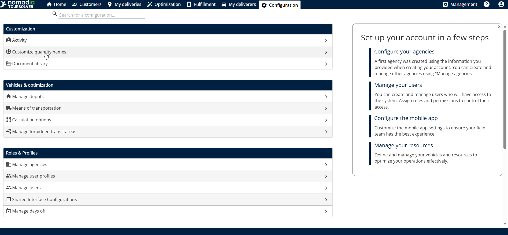
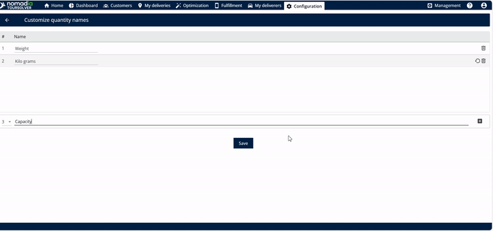
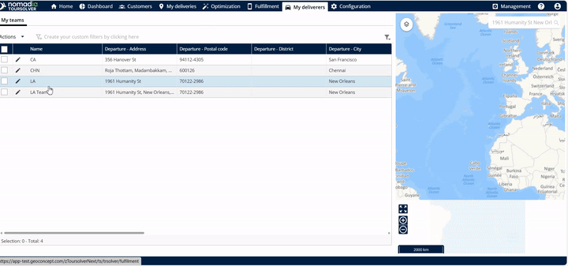
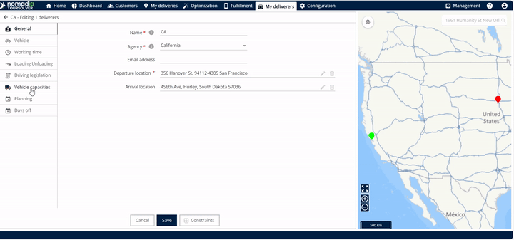
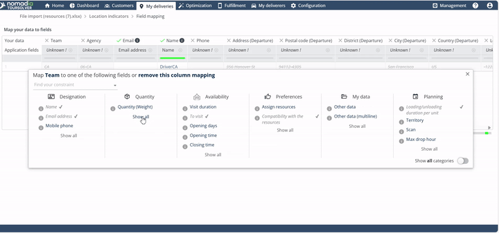

# Umbenennen einer Fahrzeugkapazität

## 1. Einführung

Das Umbenennen einer Fahrzeugmenge hilft Ihnen, die Terminologie Ihres Systems zu personalisieren. Durch das Ändern dieser Bezeichnungen sorgen Sie für Klarheit und Konsistenz beim Anzeigen von Fahrzeugkapazitäten und beim Importieren neuer Lieferinformationen. Sie lernen, wie Sie die Menge eines Fahrzeugs erfolgreich umbenennen.

## 2. Anfangskonfiguration

Gehen Sie zu _**Konfiguration → Ressourcen → Fahrzeuge**_**&#x20;und benennen Sie das Feld Menge um** um Ihr bevorzugtes Label widerzuspiegeln

## 3. Funktionsbeschreibungen und Vorteile

Die Möglichkeit, Mengenbezeichnungen anzupassen, bietet einen erheblichen Vorteil, indem benutzerdefinierte Namen in zwei wichtigen Bereichen angezeigt werden:

* **Fahrzeugkapazitätsansicht**: Nach dem Umbenennen sind die neuen Namen sichtbar, wenn Sie die Kapazitätsdetails eines Fahrzeugs prüfen. Dies ermöglicht Ihnen, schnell zu überprüfen, welche Kapazitätsbeschränkungen Ihrer Flotte zugewiesen wurden.
* **Lieferimport-Bildschirm**: Die neuen Namen werden beim Import neuer Lieferungen angezeigt. Genauer gesagt erscheinen sie, wenn Sie während des Importvorgangs unter dem Mengenbereich "Alle anzeigen" auswählen, wodurch eine korrekte Datenzuordnung sichergestellt wird.

## 4. Umbenennen einer Fahrzeugmenge

Befolgen Sie diese einfachen Schritte, um die Mengenbezeichnungen in Ihrem System zu aktualisieren:

1. **Zugriff auf Konfiguration**
2. **Navigieren Sie zu "Mengenbezeichnungen anpassen"**

<figure><figcaption></figcaption></figure>

3. **Benenne die Menge um**
4. **Speichern Sie Ihre Änderungen**

<figure><figcaption></figcaption></figure>

## 5. Überprüfung der neuen Namen in Fahrzeugkapazitäten

1. **Gehen Sie zu Meine Zusteller**
2. **Bearbeiten Sie ein Fahrzeug**

<figure><figcaption></figcaption></figure>

3. **Fahrzeugkapazitäten anzeigen**
4. **Bestätigen Sie den Namen**

<figure><figcaption></figcaption></figure>

## 6. Überprüfung der neuen Namen während des Lieferimports

Die umbenannten Mengen sind auch sichtbar, wenn Sie Lieferungen importieren:

1. **Gehen Sie zu Meine Lieferungen**
2. **Import starten**
3. **Unbekannte Felder für Adressen**
4. **Alle Mengen anzeigen**
5. **Bestätigen Sie den neuen Namen**

<figure><figcaption></figcaption></figure>

## 7. Produktivitätstipps

* **Tipp**: Sofortige Überprüfung ist entscheidend Nachdem Sie Ihre umbenannte Menge gespeichert haben, nehmen Sie sich einen Moment Zeit, um die Änderung sofort sowohl in den Fahrzeugkapazitäten als auch durch Überprüfung eines offenen Lieferimports zu verifizieren. Dadurch wird sichergestellt, dass Ihre Änderungen korrekt im System übernommen wurden.
* **Tipp**: Halten Sie es einfach Verwenden Sie klare, prägnante Namen, die für alle in Ihrem Team leicht verständlich sind. Da der neue Name in mehreren Bereichen angezeigt wird, verhindert die Wahl verständlicher Sprache Verwirrung.
* **Warnung**: Stellen Sie sicher, dass Sie alle notwendigen Felder aktualisiert haben, bevor Sie auf Speichern klicken, um zu vermeiden, dass Sie mehrmals ins Anpassungsmenü zurückkehren müssen.
